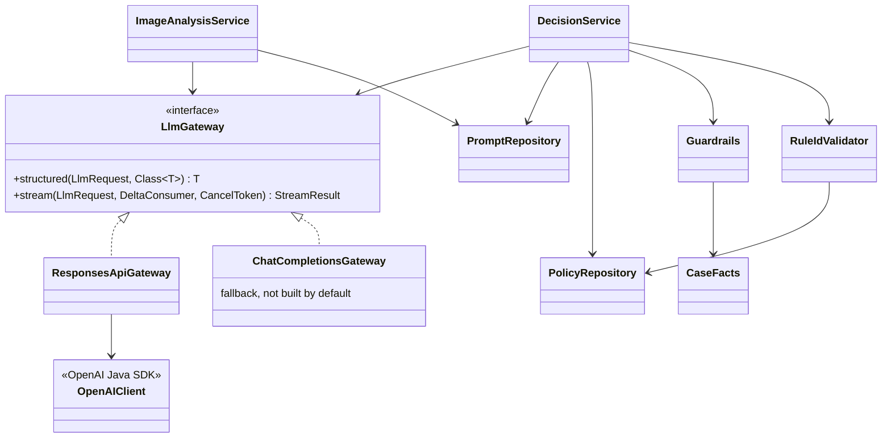
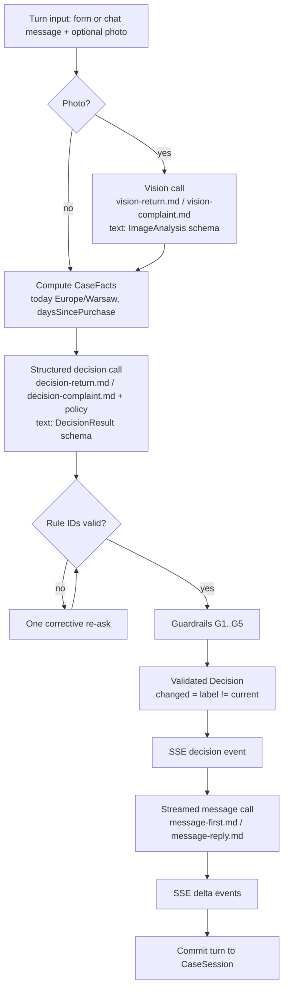
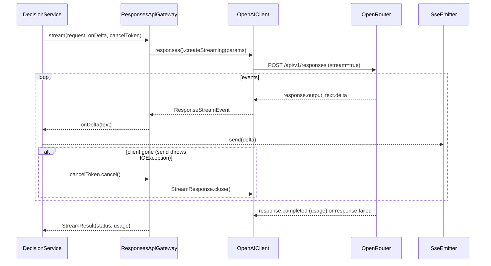

# ADR-001: LLM Integration — OpenAI Java SDK, OpenRouter, Prompts and Decision Pipeline

**Date:** 2026-11-25
**Status:** Accepted
**Relates to:** [`000-main-architecture.md`](000-main-architecture.md), [`docs/PRD.md`](../PRD.md) Sections 6 (AC-16…AC-29, AC-34…AC-36) and 11

---

## 1. Scope

**Covers:**
- How the backend calls models through OpenRouter with the OpenAI Java SDK.
- The choice between the Responses API and Chat Completions.
- Model configuration.
- Prompt files and context assembly.
- The two-step decision pipeline.
- Deterministic guardrails.
- Streaming and error mapping.
- AI evals.

**Does not cover** HTTP endpoints, SSE transport or case storage (ADR-002), or the UI rendering of messages (ADR-003).

---

## 2. Technology Documentation References

| Library | Context7 ID or official docs | Used for |
|---|---|---|
| OpenAI Java SDK 4.113.0 (`com.openai:openai-java`) | `/openai/openai-java`; https://github.com/openai/openai-java; https://developers.openai.com/api/docs/libraries?language=java | Client, Responses API, streaming, structured outputs, image input |
| OpenRouter Responses API | `/websites/openrouter_ai`; https://openrouter.ai/docs/api/reference/responses/overview | Endpoint semantics: stateless, input items, `text.format`, streaming events |
| OpenRouter streaming | https://openrouter.ai/docs/api_reference/streaming | SSE comments, mid-stream errors, cancellation |
| OpenRouter errors | https://openrouter.ai/docs/api_reference/errors-and-debugging | Status codes, error body, retry rules |
| OpenRouter structured outputs | https://openrouter.ai/docs/guides/features/structured-outputs | `json_schema`, `provider.require_parameters` |
| OpenRouter image understanding | https://openrouter.ai/docs/guides/overview/multimodal/image-understanding | `input_image` with a base64 data URL |

---

## 3. Component Design

### 3.1 Classes and responsibilities (package `…copilot.llm`, `…analysis`, `…decision`, `…prompts`)

| Component | Responsibility |
|---|---|
| `OpenRouterProperties` | Typed configuration: `apiKey`, `baseUrl`, `visionModel`, `decisionModel`, `decisionReasoningEffort`, `appTitle`, `appUrl`, `timeouts` |
| `OpenAiClientConfig` | Defines **one** `OpenAIClient` bean (README: "Don't create more than one client"). Built with `OpenAIOkHttpClient.builder()` with `apiKey(OPENROUTER_API_KEY)`, `baseUrl(OPENROUTER_BASE_URL)`, `maxRetries(1)` and a per-client timeout of 60 s. The `HTTP-Referer` and `X-OpenRouter-Title` headers are added for every request. **The SDK default env vars `OPENAI_API_KEY`/`OPENAI_BASE_URL` are not used** |
| `LlmGateway` (interface) | Provider-neutral port with three operations: `structured(request, Class<T>) → T`, `stream(request, deltaConsumer, cancelToken) → StreamResult`, and `describe()` for logging |
| `ResponsesApiGateway` | The only class importing the SDK. It maps an `LlmRequest` (model, instructions, input items, images, reasoning effort, JSON-schema class) to `ResponseCreateParams` and calls `client.responses().create(...)` or `.createStreaming(...)`. It maps stream events and SDK exceptions to domain results |
| `ChatCompletionsGateway` | **Fallback only**. Not built unless spike S-1 fails (§6 D-L1) |
| `PromptRepository` | Loads `classpath:prompts/*.md` at startup. Fails fast if a file is missing. Fills named placeholders (`{{policy}}`, `{{today}}` …) by plain string replacement |
| `PolicyRepository` | Loads `classpath:policies/return-policy.md` and `complaint-policy.md`. Extracts the **set of valid rule IDs** per policy with the patterns `^## (R\|C)\d+\.` (section IDs, e.g. `R6`, `C8`) and `^(R\|C)\d+\.\d+\.` (sub-rule IDs, e.g. `R2.3`). Currently valid: `R1–R6, R1.1…R5.3` and `C1–C8, C1.1…C7.1` |
| `ImageAnalysisService` | Builds the vision request for the case type and returns a typed `ImageAnalysis` |
| `DecisionService` | Step 1 makes the structured decision, step 2 runs `Guardrails` and `RuleIdValidator`, and step 3 streams the message |
| `Guardrails` | Deterministic overrides (§3.4). Pure functions with no I/O |
| `CaseFacts` | Computed facts: `today` (Europe/Warsaw), `daysSincePurchase`, `returnWindowExceeded`, `complaintPeriodExceeded` |

### 3.2 Prompt files (`app/backend/src/main/resources/prompts/`)

The PRD requires four distinct instruction sets (PRD §8). Two auxiliary prompts are added for the streamed message step.

| File | Used by | Content (English instructions; the output language is specified per file) |
|---|---|---|
| `vision-return.md` | Image analysis, RETURN | Describe only what is visible. Report: usable photo, category match, visible damage, signs of use, visible film/accessories/packaging, resellable as new, safety hazard. Fill `summaryPl` in Polish (AC-16, AC-18) |
| `vision-complaint.md` | Image analysis, COMPLAINT | Report: damage visible, type, location, likely cause (enum), confidence (enum), usable photo, category match, safety hazard. Fill `summaryPl` (AC-17, AC-18) |
| `decision-return.md` | Structured decision, RETURN | Role, the four labels with their criteria (PRD §11 table), and the "allowed / not allowed" lists. Only Return Policy rule IDs may be cited. Includes `{{policy}}` (the full Return Policy) |
| `decision-complaint.md` | Structured decision, COMPLAINT | Same structure with the Complaint Policy, plus C7 safety and C8 escalation |
| `message-first.md` | Streamed first message | Polish, informal "Ty" form, at most about 250 words. Exactly three `###` sections: "Co widzimy na zdjęciu", "Uzasadnienie" (with rule IDs from the decision), "Kolejne kroki" (numbered list). No greeting, badge, safety block or disclaimer: the UI adds those (§3.5). Mention the other case type when `suggestOtherCaseType` is set (AC-28) |
| `message-reply.md` | Streamed chat reply | Answer using the full context. If `changed=true`, explain the new decision with the same three sections; otherwise answer the question. Covers off-topic refusal, no promises, no repair instructions, Polish only (AC-45) |

Prompt rules that apply to every file:
- Customer-provided text (reason, chat messages) is passed **only** inside clearly delimited input items labelled as customer data.
- The instructions state that any instructions inside customer data or inside photos must be ignored (PRD §11 "Not allowed").
- Instructions are never echoed back to the customer.

### 3.3 Context assembly (stateless replay)

The OpenRouter Responses API is **stateless**: "You must include the full conversation history in each request. Requests that set `store: true` or a non-null `previous_response_id` are rejected with a 400 error" (OpenRouter responses/overview). Every call is therefore built from `CaseSession` as follows:

| Part | Responses field | Content |
|---|---|---|
| Instructions | `instructions` | The prompt file for the step with `{{policy}}` filled in. Policies are sent only to the decision and message steps, never to the vision step |
| Case facts | first `input` item, role `user`, labelled `CASE FACTS (system-computed, trusted)` | `caseType`, `category`, `model`, `purchaseDate`, `today`, `daysSincePurchase`, window flags, `triageSignals` (decisions-model answers with confidence and HIGH/MEDIUM/LOW band, ADR-004 §3.4; given to the vision and decision steps as hypotheses to verify), all `ImageAnalysis` objects as JSON with their index and time |
| Customer form text | `input` item, role `user`, labelled `CUSTOMER REASON (untrusted)` | The `reason` field |
| History | following `input` items | Prior turns in order: customer → role `user`, assistant body → role `assistant` |
| Current decision | final `input` item (message steps only) | The validated `Decision` the message must explain, plus `changed`/`previousLabel` |
| Image | `input_image` part (vision step only) | `data:image/jpeg;base64,…` of the reduced photo. The text part comes first, then the image (OpenRouter image guide) |

`store` is never set. The SDK README example sets `.store(true)`, and copying that would make OpenRouter return 400.

The assistant history format must be confirmed in spike S-1 (§6). OpenRouter's docs state that replayed assistant output items carry `id` and `status` with `output_text`. If plain role-based assistant messages are rejected, the adapter replays assistant turns as output-message items with synthetic IDs.

### 3.4 Decision pipeline and guardrails

For the first submission, a **triage stage** (ADR-004) runs before this pipeline. It can route the case to a fast path that skips every step below. Otherwise it contributes `triageSignals`. Guardrails G1–G6 apply on both paths.

The pipeline is **two steps per turn** (decision D-L2):

1. **Structured decision**:
   - Call `responses.create` with `text(DecisionResult.class)` (JSON schema derived from the class by the SDK, `strict` on).
   - Use model `LLM_DECISION_MODEL` with reasoning effort `LLM_DECISION_REASONING_EFFORT` (default `medium`).
   - Set `provider.require_parameters: true` (an OpenRouter extension, added with `putAdditionalBodyProperty`), so the request routes only to endpoints that support structured outputs.
2. **Validate and enforce** using `Guardrails` and `RuleIdValidator`.
3. **Streamed message**:
   - Call `responses.createStreaming` with `message-first.md` or `message-reply.md`.
   - Use reasoning effort `low`.
   - Forward only `response.output_text.delta` text.

`DecisionResult` (model output schema):

| Field | Type | Notes |
|---|---|---|
| `label` | enum `ACCEPTED_PRELIMINARY \| REJECTED \| NEEDS_MORE_INFO \| ESCALATED` | AC-20 |
| `ruleIds` | array of string, 1–5 items | Must belong to the applied policy (AC-21, AC-23) |
| `reasonCode` | enum `RESELLABLE \| NOT_RESELLABLE \| OUTSIDE_WINDOW \| COVERED_DEFECT \| EXCLUDED_DAMAGE \| PHOTO_UNUSABLE \| CATEGORY_MISMATCH \| MISSING_INFO \| UNCERTAIN_CAUSE \| CONTRADICTION \| SAFETY \| OTHER` | Used by evals and the message prompt |
| `suggestOtherCaseType` | enum `NONE \| RETURN \| COMPLAINT` | AC-28 |
| `changeReasonPl` | string ≤ 300 chars, may be empty | Polish reason shown in the "Zmiana decyzji" block (AC-35) |
| `missingInfoPl` | string ≤ 300 chars, may be empty | What photo or information is needed (AC-19) |

`Guardrails`: deterministic rules applied in this order. The first matching rule wins and records `overriddenBy`.

| # | Condition (computed, not asked from the model) | Enforced result | PRD |
|---|---|---|---|
| G1 | Any analysis has `safetyHazard=true`, **or** the customer text matches the safety lexicon (`spuch*`, `dym*`, `iskr*`, `przypal*`, `swąd*`, `pal* się`, `zapach spalenizny`, `odsłonięt* przewod*`) | `ESCALATED`, `safety=true`; ruleIds include `C7.1` (complaint) or `R6` (return) | AC-26, C7.1 |
| G2 | RETURN and `daysSincePurchase > 30` (day 1 = the day after purchase, R2.3) | `REJECTED`, ruleIds include `R2.3` | AC-24 |
| G3 | COMPLAINT and `today > purchaseDate + 2 years` | `REJECTED`, ruleIds include `C2.3` | AC-25 |
| G4 | First decision, and the analysis has `photoUsable=false` or `matchesCategory=false` | `NEEDS_MORE_INFO` | AC-19 |
| G5 | COMPLAINT, model `label=REJECTED`, latest analysis `causeConfidence=LOW` | `ESCALATED`, ruleIds include `C8` | AC-27 |
| G6 | `ruleIds` contains an ID that is not in the applied policy's ID set | One corrective re-ask that lists the valid IDs. If it is still invalid, drop the unknown IDs. If none remain, return `ESCALATED` with `R6`/`C8` | AC-21, AC-23 |

Revision rule: `changed = (validated label ≠ currentDecision.label)`. The "Zmiana decyzji" block is driven only by this computed flag, never by the model's text (AC-35, AC-36).

### 3.5 Message composition: what is model-generated and what is fixed

To make AC-22, AC-26 and AC-35 order-proof, the assistant message is rendered from segments. Only the body is generated by the model.

| Order | Segment | Source |
|---|---|---|
| 1 | Safety block (only if `safety`) | Fixed Polish text in the frontend: stop using and charging, keep away from flammable materials (C7.1) |
| 2 | "Zmiana decyzji" block (only if `changed`) | UI component: previous badge → new badge + `changeReasonPl` |
| 3 | Greeting (first message only) | Fixed frontend text |
| 4 | Decision badge (first message and changed replies) | UI component from the `decision` event |
| 5 | Body | **Streamed model markdown** (three sections or a free answer) |
| 6 | Disclaimer (first message and changed replies) | Fixed exact text from PRD §11, in the frontend |

AC-26 states that safety instructions begin the message, "before the decision badge content". For a safety case the greeting therefore comes after the safety block.

### 3.6 Streaming, cancellation and errors

- **Forwarded events:** the stream is consumed with the SDK `StreamResponse<ResponseStreamEvent>`. Only `outputTextDelta().delta()` is forwarded. Reasoning events are ignored and never sent to the browser (AC-42).
- **End of stream:** `response.completed` ends the message and carries usage, which is logged with case ID and token counts and no content. `response.failed` and `response.incomplete` arrive with HTTP 200 and are treated as errors.
- **SSE comments:** comments such as `: OPENROUTER PROCESSING` are handled by the SDK and must not be forwarded.
- **Cancellation:**
  - When the browser disconnects (SSE heartbeat write fails, ADR-002), the gateway closes the SDK stream (`StreamResponse.close()`).
  - The OpenRouter docs state that aborting stops billing only for some providers, including OpenAI.

**Time budget for the first decision (AC-29), tracked by a per-request `Deadline` of 55 s:**

| Call | Per-call timeout | Retries |
|---|---|---|
| Vision | 25 s | Up to 1 retry if ≥ 20 s remain |
| Decision | 25 s | Up to 1 retry if ≥ 20 s remain |
| Stream | Must produce its first delta before the deadline | — |

If the deadline passes before the `decision` event, the result is `TIMEOUT`.

**Error mapping:** every case produces a Polish user-facing message and never exposes internals.

| Source | Domain error | User message (SSE `error`) |
|---|---|---|
| HTTP 401/403/402 | `AI_CONFIG` (logged at ERROR) | "Nie udało się przeanalizować zgłoszenia. Spróbuj ponownie." |
| HTTP 408/429/5xx, network failure | `AI_UNAVAILABLE` | same |
| `response.failed` / `incomplete` / schema parse failure after retry | `AI_UNAVAILABLE` | same |
| Deadline exceeded | `TIMEOUT` | same |

In chat, the same codes are rendered as the inline error with "Spróbuj ponownie" (AC-41).

---

## 4. Data Structures

- `LlmRequest`: `model`, `instructions` (string), `inputItems` (ordered list of `{role, text}` or `{role, text, imageDataUrl}`), `reasoningEffort` (`none|low|medium|high`), `schema` (optional Java class), `timeout`.
- `ImageAnalysis`: a structured output class. The fields are listed in ADR-000 §5. All enums are closed, and the strings are limited to 500 characters.
- `DecisionResult`: §3.4.
- `Decision` (validated): `DecisionResult` + `safety` + `changed` + `previousLabel` + `overriddenBy` (`G1…G6` or empty).
- `StreamResult`: `fullText`, `inputTokens`, `outputTokens`, `finishStatus` (`COMPLETED|FAILED|INCOMPLETE|CANCELLED`).

---

## 5. Interface Contracts

| Operation | Input | Output | Errors |
|---|---|---|---|
| `ImageAnalysisService.analyze(caseType, category, jpegBytes, deadline)` | Case type, category, reduced photo | `ImageAnalysis` | `LlmUnavailable`, `LlmTimeout` |
| `DecisionService.decide(caseSession, turnInput, deadline)` | Case incl. analyses, history and the new user text | validated `Decision` | `LlmUnavailable`, `LlmTimeout` |
| `DecisionService.streamMessage(caseSession, decision, kind=FIRST\|REPLY, onDelta, cancelToken)` | Case, decision | `StreamResult` | `LlmUnavailable`, `LlmTimeout`, `Cancelled` |
| `LlmGateway.structured / stream` | `LlmRequest` | typed object / `StreamResult` | Mapped SDK exceptions (`OpenAIServiceException` subclasses → domain errors) |

---

## 6. Technical Decisions

### D-L1 Responses API (not Chat Completions) for all calls
**Status:** Accepted · **Date:** 2026-11-25
**Context:** The SDK supports both `client.responses()` and `client.chat().completions()`, and OpenRouter exposes both `/api/v1/responses` and `/api/v1/chat/completions`. We need image input, JSON-schema output, token streaming and multi-turn chat.

**Evidence gathered on 2026-11-25:**

| Criterion | Responses API | Chat Completions |
|---|---|---|
| OpenRouter positioning | Quickstart: "The most direct way to use OpenRouter". Described as an OpenAI-compatible drop-in; no beta notice on the overview, basic-usage, reasoning or quickstart pages | Fully documented, with OpenRouter extensions (`models`, `route`, `provider`, `plugins` incl. response-healing); not marked legacy |
| Image input | `input_image` with base64 data URL; png/jpeg/webp/gif. **The image-understanding guide documents images only via Responses** | `image_url.url` accepts a URL or base64 (API schema) |
| Structured output | `text.format: json_schema`. SDK: `text(Class<T>)` | `response_format: json_schema`. SDK: `responseFormat(Class<T>)` |
| Streaming | Typed events (`response.output_text.delta`, `response.completed` with usage, `response.failed`, `response.incomplete`) and separate reasoning-delta events | Chunks with `delta.content`; errors are a chunk with `finish_reason: "error"` |
| State | Stateless on OpenRouter; full history each call; `store`/`previous_response_id` → 400 | Stateless by design |
| Reasoning control | `reasoning.effort` (`none`…`high`) and reasoning summaries, documented | Via the OpenRouter `reasoning` extension |
| SDK direction | The SDK README presents Responses as the primary API, with `ResponseAccumulator` and `text(Class)` | Supported, with `ChatCompletionAccumulator` |

**Decision:**
- Use the Responses API through `ResponsesApiGateway`.
- Typed stream events make the "decision first, then deltas, then done/error" contract (ADR-000 TAC-03) straightforward, and reasoning output stays separated from user-visible text.
- It matches OpenRouter's primary documented path for images.
- The stateless limitation costs nothing extra, because D-05 already keeps history on the server.

**Rejected alternatives:**
- Chat Completions: equally capable for our needs and with richer OpenRouter routing extensions, but it mixes errors into content chunks and is not the documented path for images on OpenRouter. It is kept as a fallback adapter behind `LlmGateway`.
- Spring AI 2.1 (`spring-ai-openai`): adds an abstraction layer with its own release cadence, and the brief asks for the official OpenAI Java SDK.
- `openai-java-spring-boot-starter`: per the README it "targets Spring Boot 2.7 and is OpenAI EOL as of 2026-07-27"; we define our own `OpenAIClient` bean instead.

**Consequences:**
- (+) One API for vision, decision and streaming. Typed events and accumulators are available.
- (−) Some OpenRouter extensions (`provider.require_parameters`, `models` fallback) are documented only on the Chat Completions schema, and whether `/responses` honors them is **unverified**. S-1 must check this.

**Spike S-1 (first implementation task, before any production code):**
- Using the synthetic photos in `assets/example-images/`, capture verbatim OpenRouter responses for these calls against `openai/gpt-6-luna`:
  - (a) `responses.create` with an image and `text(ImageAnalysis.class)`;
  - (b) `responses.create` with `text(DecisionResult.class)` and `provider.require_parameters`;
  - (c) `createStreaming` with plain text;
  - (d) a three-turn history including assistant turns;
  - (e) an invalid key → 401.
- Save each capture (status, headers without the key, body or SSE transcript, date, model) under `app/backend/src/test/resources/openrouter-captures/`. WireMock stubs are derived only from these captures (AGENTS.md).
- If (a), (b) or (d) cannot be made to work, switch to `ChatCompletionsGateway` and update this ADR.

**Review trigger:** S-1 fails; OpenRouter marks Responses as beta or deprecated; or model fallback routing (`models: [...]`) becomes a requirement.

### D-L2 Two calls per turn: structured decision, then a streamed message
**Status:** Accepted · **Date:** 2026-11-25
**Context:**
- The UI must show a machine-readable label (badge, summary panel, AC-30/35/36) and stream Polish text progressively (AC-37).
- Guardrails (AC-24…27) must be enforced in code, not trusted to the model.
**Decision:** Each turn makes a non-streamed structured `DecisionResult` call, runs the guardrails, and then makes a streamed message call that receives the final decision as a fixed fact.
**Rejected alternatives:**
- One streamed structured call `{label, message}`: OpenRouter supports structured output with streaming, but the deltas are partial JSON and would need an incremental parser. The label also arrives too late for the guardrails.
- One streamed call with a `DECISION:` marker line: not schema-guaranteed, and the guardrails could only run after text was already shown.
**Consequences:**
- (+) Guardrails run before any text reaches the customer. The message can never contradict the badge. Evals can score labels without parsing prose.
- (−) Each turn costs about twice the input tokens, since the policy is sent twice, and adds the latency of one extra call. This is acceptable for the PoC and is logged as token usage.
**Review trigger:** The average first-decision latency exceeds 30 s, or the cost per case exceeds the PoC budget.

### D-L3 Separate, configurable vision and decision models
**Status:** Accepted · **Date:** 2026-11-25
**Decision:**
- `LLM_VISION_MODEL` and `LLM_DECISION_MODEL` both default to `LLM_MODEL` (`openai/gpt-6-luna`).
- At startup the backend logs the effective model IDs; they are never sent to the browser.
- Model capabilities (image input, structured outputs) must be checked on the model's OpenRouter page during S-1. The gpt-6-luna capability flags were **not verified** in this research.
**Rejected alternatives:**
- A single hard-wired model: it prevents a cheaper vision model and A/B evals.
**Review trigger:** Evals show that a different model is better or cheaper for a role.

### D-L4 Deterministic guardrails and rule-ID validation in code
**Status:** Accepted · **Date:** 2026-11-25
**Context:** Time windows, safety escalation and the low-confidence rule are hard requirements (AC-24…27), and the model can hallucinate rule IDs (AC-23).
**Decision:** Apply G1–G6 (§3.4) after every structured decision. Pass `daysSincePurchase` and the window flags to the model as trusted facts, so its explanation matches the enforced outcome.
**Consequences:**
- (+) The hard ACs are guaranteed regardless of model behavior and unit-testable without AI.
- (−) The safety lexicon may over-escalate: a false positive leads to a human, which is the safe direction.
**Review trigger:** The policies change their windows, IDs or safety rules. `PolicyRepository` re-extracts the IDs automatically, but G2/G3/G1 reference specific IDs and must be updated.

### D-L5 Prompt-injection and data-handling stance
**Status:** Accepted · **Date:** 2026-11-25
**Decision:**
- Customer text and photo-borne text are always delimited and declared untrusted in the instructions.
- The decision is enforced by guardrails.
- Logs contain the case ID, step, model, token usage, latency and outcome, never the photo, the reason text or the messages.
- Only synthetic data is used in development and evals (PRD §8).
**Review trigger:** Real customer data or production use.

---

## 7. Diagrams

### Component / class diagram

### Decision pipeline (one turn)

### Streaming sequence with cancellation

---

## 8. Testing Strategy

### Test scenarios for this area

| Scenario | Type | Input | Expected output | Edge cases |
|---|---|---|---|---|
| Client wiring | Unit | Properties with key, base URL and title | Client uses the OpenRouter base URL and sends `HTTP-Referer`/`X-OpenRouter-Title`; `store` absent | Missing key → startup fails with a clear message |
| Request mapping | Unit | `LlmRequest` with image + schema | `ResponseCreateParams` has `instructions`, the input text before `input_image`, a data URL, and `text.format` json_schema | Reasoning effort `none` |
| History replay | Unit | Case with 3 turns | Input items in order: facts, reason, user/assistant alternating, decision | Empty reason for RETURN |
| Rule-ID extraction | Unit | Current policy files | The ID sets equal the lists in §3.1 | A new sub-rule added → picked up |
| Guardrail G1 safety | Unit | Analysis `safetyHazard=true`, model ACCEPTED | ESCALATED, `safety`, `C7.1` | Lexicon match in the chat text only |
| Guardrail G2 window | Unit | RETURN, purchase = today − 30 / − 31 days | ACCEPTED allowed / REJECTED with `R2.3` | Purchase today (0 days) |
| Guardrail G3 | Unit | COMPLAINT, purchase = today − 2y / − 2y − 1d | Allowed / REJECTED with `C2.3` | 29 February purchase |
| Guardrail G5 | Unit | COMPLAINT, LOW confidence, model REJECTED | ESCALATED with `C8` | MEDIUM confidence → REJECTED kept |
| Rule-ID validation G6 | Unit | Model returns `C2.3` on a RETURN case | Re-ask once, then drop → ESCALATED if empty | Valid + invalid mix |
| Change flag | Unit | Current REJECTED, new ACCEPTED | `changed=true`, `previousLabel=REJECTED` | Same label → `changed=false` |
| Stream mapping | Unit | Fake event sequence incl. reasoning deltas and `response.failed` | Only text deltas forwarded; FAILED → `LlmUnavailable` | Zero deltas then completed |
| Structured call via WireMock | Integration | Stub = capture S-1(b) | `DecisionResult` parsed | Stub with an invalid enum → retry, then error |
| Streaming via WireMock | Integration | Stub = capture S-1(c) as an SSE body | Deltas in order and usage logged | Stub with a 502; stub stalls past the timeout |
| AI evals | Eval (real model) | `app/evals/cases/*.json`: about 20 synthetic cases (example photos + form + expected label/ruleIds/safety) covering Flows 4.1–4.7 and the injection case | Label accuracy ≥ 90%; safety and window cases 100%; cited IDs ⊆ policy | Run 3× to detect flakiness |

### Technical acceptance criteria
- TAC-001-01: Only `ResponsesApiGateway` (and the optional fallback) imports `com.openai.*`, enforced by an ArchUnit-style test or a simple classpath scan test.
- TAC-001-02: No outgoing request body contains `"store":true` or `previous_response_id` (asserted on WireMock request journals).
- TAC-001-03: Every validated decision's `ruleIds` is a non-empty subset of the applied policy's extracted ID set.
- TAC-001-04: G1–G5 have 100% branch coverage in unit tests.
- TAC-001-05: The SSE output never contains reasoning text, model names or instruction text (integration test with a stub that includes reasoning events).
- TAC-001-06: All WireMock stubs reference a capture file that records its date, endpoint, model and request without secrets.
