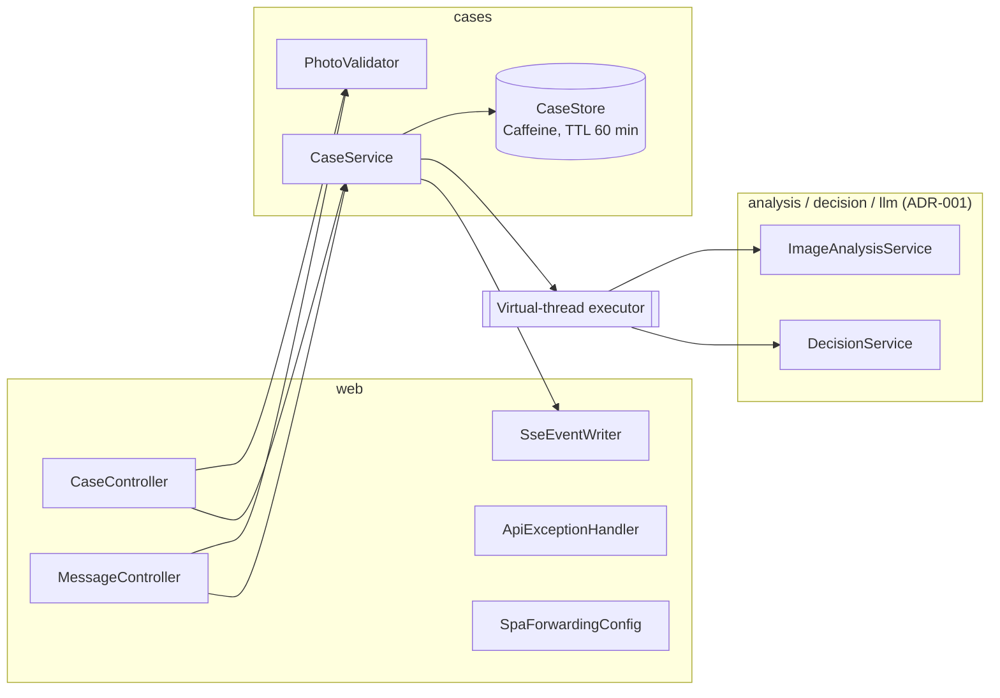
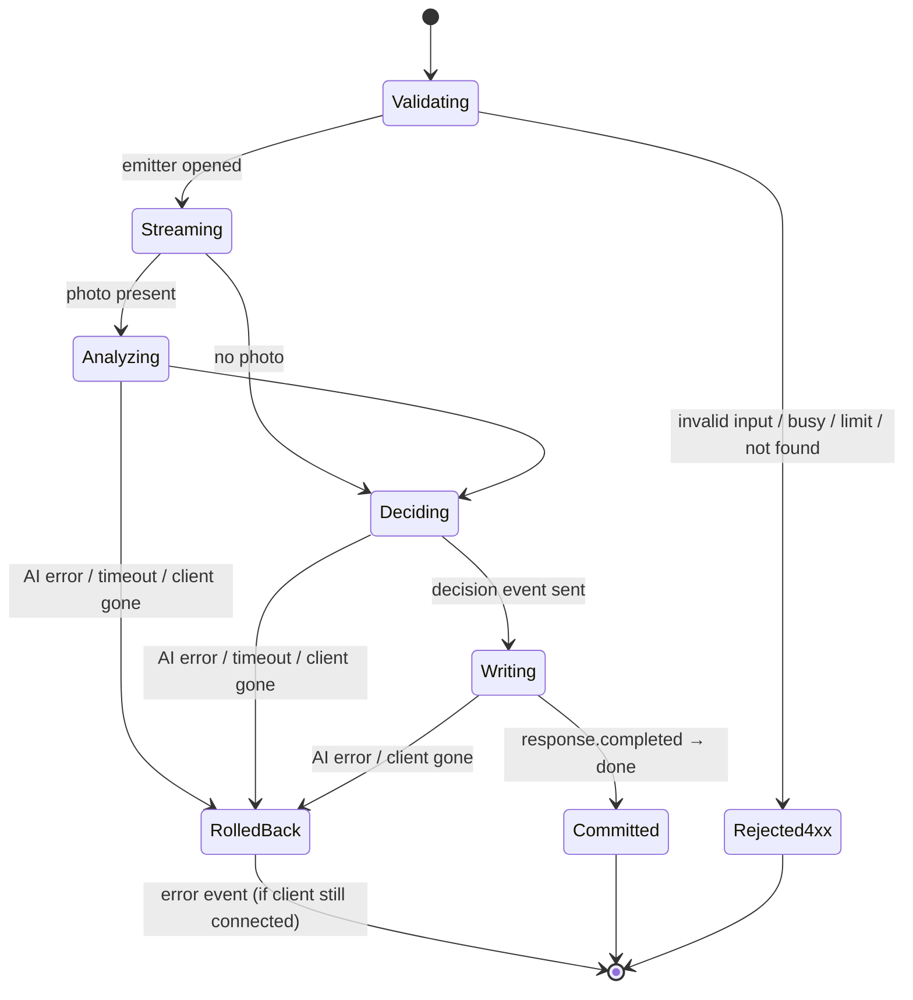
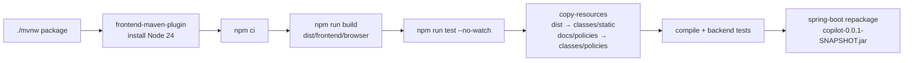
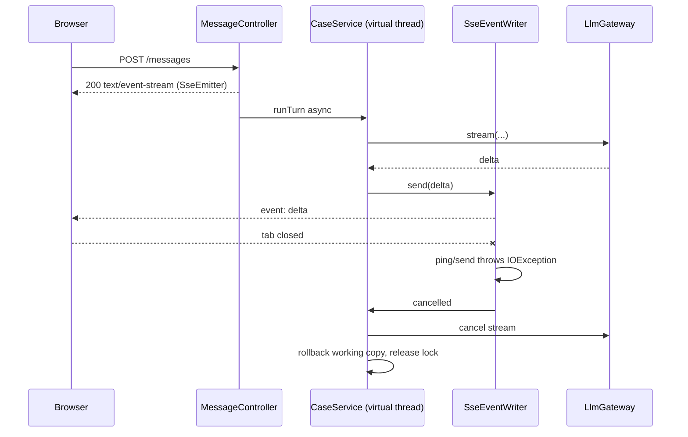

# ADR-002: Backend — Spring Boot 4.2, Maven, REST/SSE API, Case State and Packaging

**Date:** 2026-11-25
**Status:** Accepted
**Relates to:** [`000-main-architecture.md`](000-main-architecture.md), [`001-llm-integration.md`](001-llm-integration.md)

---

## 1. Scope

**Covers:**
- Toolchain installation and project initialization with Maven and Spring Boot.
- Backend package layout.
- The HTTP and SSE API, with validation.
- The in-memory case store and concurrency.
- Error handling.
- Configuration.
- Building the Angular app into the JAR and SPA routing.
- Backend tests.

**Does not cover** LLM calls, prompts and guardrails (ADR-001), or the Angular code (ADR-003).

---

## 2. Technology Documentation References

| Library | Version | Context7 ID or official docs | Used for |
|---|---|---|---|
| Spring Boot | 4.2.0 | `/spring-projects/spring-boot/v4.1.0`, `/websites/spring_io_spring-boot`; https://docs.spring.io/spring-boot/system-requirements.html; https://github.com/spring-projects/spring-boot/wiki/Spring-Boot-4.2-Release-Notes; https://github.com/spring-projects/spring-boot/wiki/Spring-Boot-4.0-Migration-Guide | Framework, starters, properties |
| Spring Framework | 7.1.x | `/spring-projects/spring-framework/v7.0.5`, `/websites/spring_io_spring-framework_current_javadoc-api` | `SseEmitter`, MVC async, WebMvc.fn routing, MockMvcTester |
| Spring Initializr | — | https://start.spring.io, https://github.com/spring-io/start.spring.io/blob/main/USING.adoc | Project generation |
| Maven / Maven Wrapper | 3.10.2 / wrapper | https://maven.apache.org/download.cgi, https://maven.apache.org/tools/wrapper/ | Build |
| OpenJDK 25 | 25.0.5 (Ubuntu `openjdk-25-jdk`) | https://packages.ubuntu.com/search?keywords=openjdk-25-jdk; https://sdkman.io/jdks | Runtime |
| Caffeine | 3.3.1 (Boot-managed) | https://github.com/ben-manes/caffeine/wiki | Case store |
| frontend-maven-plugin | 2.0.2 | https://github.com/eirslett/frontend-maven-plugin | Node install, `npm ci`, `npm run build` |
| maven-resources-plugin | Boot-managed | https://maven.apache.org/plugins/maven-resources-plugin/ | Copy the Angular dist and the policies into `target/classes` |
| wiremock-spring-boot | 4.4.3 (`org.wiremock.integrations`) | https://wiremock.org/docs/spring-boot/ | OpenRouter stub in integration tests |
| JUnit Jupiter | 6.1.3 (Boot-managed) | https://docs.junit.org/ | Tests |

---

## 3. Component Design

### 3.1 Toolchain installation (course VM, Ubuntu)

| Step | Command | Note |
|---|---|---|
| JDK 25 | **Installed on the course VM (2026-11-26):** `openjdk 25.0.5.1` (Ubuntu `openjdk-25-jdk`) | On another machine: `sudo apt install openjdk-25-jdk`, or SDKMAN (`sdk install java <25.x-tem>`) |
| Spring Boot CLI | **Installed:** v4.1.0 at `~/.sdkman/candidates/springboot/current/bin/spring` (not on `PATH`; agents call it by full path) | It is the project generator (§3.2) |
| Maven | **Not installed system-wide.** The generated project contains the Maven Wrapper (`mvnw`), which downloads the pinned Maven 3 version into `~/.m2` | The exact version comes from `.mvn/wrapper/maven-wrapper.properties`. Maven 4 is still RC (4.0.0-rc-7), so do not use it. If `mvnw` is not executable after generation, run it as `sh mvnw …`, because `chmod` is denied for agents |
| Node | Node 24 is already on the VM and is used for `ng` during development | The Maven build downloads its own Node with frontend-maven-plugin, so CI builds do not depend on the system Node |
| Verify | `java -version` shows 25, and `./mvnw -v` shows Maven 3.x on Java 25 | Record the output in the scaffolding task summary |

### 3.2 Project initialization (Spring Initializr via Spring Boot CLI, Maven)

Generate into `app/backend` from the repository root with the **Spring Boot CLI** (`spring init`). It calls the Initializr service with these parameters:

| Parameter | Value | Reason |
|---|---|---|
| `type` | `maven-project` | Maven + wrapper |
| `language` | `java` | — |
| `bootVersion` | `4.2.0` | Current GA, the Initializr default on 2026-11-25 |
| `javaVersion` | `25` | **Must be explicit.** The Initializr default is 17 |
| `groupId` / `artifactId` / `name` | `com.hsdc` / `copilot` / `copilot` | Fictional store namespace (PRD §8) |
| `packageName` | `com.hsdc.copilot` | — |
| `packaging` | `jar` | One runnable JAR (D-01) |
| `dependencies` | `web,validation,actuator,configuration-processor,devtools,cache` | `web` = Spring Web (MVC). In Boot 4 this yields `spring-boot-starter-webmvc` + `spring-boot-starter-webmvc-test`; check the generated POM, and if it shows the deprecated `spring-boot-starter-web`, replace it with `spring-boot-starter-webmvc` |
| location | `app/backend` | Extracted directly into the target folder |

**Command,** run from the repository root:
`~/.sdkman/candidates/springboot/current/bin/spring init --build=maven --type=maven-project -l java -b 4.2.0 -j 25 -g com.hsdc -a copilot -n copilot --package-name com.hsdc.copilot --packaging jar -d web,validation,actuator,configuration-processor,devtools,cache app/backend`

**Required flags:**
- **`--build=maven` is mandatory,** because `spring init` defaults to Gradle.
- `-b` and `-j` must be explicit.

**Equivalent without the CLI** (for humans; `curl` is denied for agents):
`curl https://start.spring.io/starter.zip -d type=maven-project … -o backend.zip`, with the same parameters.

**After generation:**
1. Check that `pom.xml`, `mvnw` and `.mvn/wrapper/` exist and that there is no `build.gradle`.
2. Move the single generated property (`spring.application.name`) from `src/main/resources/application.properties` into `application.yml` (§3.9), then remove `application.properties` with `git rm` after its first commit, or ask the human to delete it. A leftover `.properties` file would take precedence over the YAML.
3. Delete `HELP.md` in the same way.

Dependencies added by hand to the generated POM (versions pinned in `<properties>`):

| Dependency | Scope | Purpose |
|---|---|---|
| `com.openai:openai-java:4.113.0` | compile | LLM client (ADR-001) |
| `com.github.ben-manes.caffeine:caffeine` (Boot-managed version) | compile | Case store |
| `org.wiremock.integrations:wiremock-spring-boot:4.4.3` | test | OpenRouter stub. Boot 4 compatibility is unverified, so check it in the first integration test. If it is incompatible, use plain `org.wiremock:wiremock:3.13.2` with a `@DynamicPropertySource` base URL |

**Build plugins configured by hand in the POM** (T10 of the plan):

| Plugin | Configuration | Why |
|---|---|---|
| `maven-surefire-plugin` (Boot-managed) | Runs `*Test` classes. `<excludedGroups>${test.excludedGroups}</excludedGroups>`, with the property defaulting to `capture,eval` | Unit tests. The tagged real-API tests are excluded by default, and the exclusion can be cleared from the command line |
| `maven-failsafe-plugin` (Boot-managed, **must be declared** in `<build><plugins>` with the `integration-test` and `verify` goals) | Runs `*IT` classes, with the same `excludedGroups` property | Without this declaration, `*IT` classes are silently never run, and a run with zero tests looks green |
| `jacoco-maven-plugin` | `prepare-agent` + `report`; coverage check on the `decision` package (TAC-001-04) | Branch-coverage requirement |
| `frontend-maven-plugin`, `maven-resources-plugin` | §3.8 | Angular build and policies |

**Commands:**

| Purpose | Command |
|---|---|
| Unit tests only | `./mvnw -Pno-frontend test` |
| Unit + integration tests | `./mvnw -Pno-frontend verify` |
| Real-API tests | `./mvnw -Pno-frontend verify -Dtest.excludedGroups= -Dgroups=eval` (or `=capture`) |

Boot 4 points the implementing agent must respect (from the 4.0 migration guide and the 4.2 release notes):
- **Jackson:** Jackson 3 is the default JSON library, with packages under `tools.jackson.*` (except `jackson-annotations`). Do not add Jackson 2.
- **MockMvc in tests:** `@SpringBootTest` alone no longer provides MockMvc. Add `@AutoConfigureMockMvc`, and prefer `MockMvcTester`.
- **HTTP clients:** `TestRestTemplate` and `RestTemplate` are deprecated. Use `RestTestClient` in tests if an HTTP client test is needed.
- **Tomcat properties:** servlet properties live under `server.tomcat.servlet.*`.
- **DevTools:** livereload is off by default.

### 3.3 Package layout (`com.hsdc.copilot`)

| Package | Main types | Responsibility |
|---|---|---|
| `web` | `CaseController`, `MessageController`, `SseEventWriter`, `ApiExceptionHandler`, `SpaForwardingConfig` | HTTP mapping, request validation, SSE emission, error bodies, SPA fallback |
| `cases` | `CaseService`, `CaseStore`, `CaseSession`, `CaseForm`, `ChatMessage`, `TurnInput`, `PhotoValidator` | Lifecycle, per-case locking, turn orchestration, commit/rollback of a turn |
| `analysis`, `decision`, `llm`, `prompts`, `policy` | see ADR-001 | AI pipeline |
| `triage` | `DecisionsApiClient` (Spring `RestClient`), `TriageService`, `TriageRouter`, `FastPathRuleTable`, `FastPathMessageRenderer` | Decisions-model triage and fast path (ADR-004) |
| `config` | `AppProperties`, `OpenRouterProperties`, `ClockConfig`, `ExecutorConfig`, `CaseStoreConfig`, `OpenAiClientConfig` | Typed `@ConfigurationProperties` (validated), beans |

### 3.4 Turn orchestration and state

`CaseService.runTurn` handles both the first decision and chat turns:

1. Acquire the case's `ReentrantLock` with `tryLock()`. If it is busy, return **409** so that two concurrent turns cannot interleave history.
2. Build a **working copy** of the turn: user message, new analysis and incremented photo counter.
3. Run the pipeline (ADR-001) and emit `progress`, then `decision`, then `delta` events.
4. On success, **commit atomically**: append the user message, analysis and assistant message, set `currentDecision` and `additionalPhotoCount`, re-`put` the session into the store, and then emit `done`.
   - A client disconnect **after** the commit is not rolled back. The turn is complete, and a retry replays it (below).
   - On any error **before** the commit, discard the working copy (AC-41: a retry is a clean re-run) and emit `error`.
5. Release the lock.

**Idempotency and replay:**
- `clientMessageId` is stored with each committed user message.
- A repeated `clientMessageId` that is **already committed** returns `200 text/event-stream` and **replays** the committed turn: `decision` (from its snapshot), one `delta` with the full assistant text, then `done`. No AI call is made.
- This covers a client that lost the stream before `done`, and it keeps AC-41's "Spróbuj ponownie" idempotent.
- A repeated ID whose turn is **still running** returns 409 `CASE_BUSY`.

**Chat-turn deadline:** the same 55 s budget to the `decision` event as the first submission (ADR-001 §3.6).

**First submission:** `POST /api/cases` creates the session in the store **only on success**. A failed first decision leaves no orphan case, and the client retries with the same data (AC-40).

**Store:**
- Caffeine `Cache<UUID, CaseSession>` with `expireAfterAccess(CASE_TTL_MINUTES)` (default 60) and `maximumSize(500)`. It is used directly, not through `@Cacheable`, which is meant for memoizing method results.
- During a turn, `CaseService` holds a strong reference to the `CaseSession`, and the commit re-`put`s it. An eviction by size or TTL during a long turn therefore cannot lose the committed result.
- A case evicted **between** turns is gone: 404, and the UI offers "Nowa sprawa".

**Threads:**
- `spring.threads.virtual.enabled=true`.
- Turn work runs on an executor from `Executors.newVirtualThreadPerTaskExecutor()`, defined as a bean and shut down on context close. The request thread returns the `SseEmitter` immediately.

**"Today":** an injected `Clock` fixed to the zone `APP_ZONE` (default `Europe/Warsaw`, PRD §12). Tests inject `Clock.fixed`.

### 3.5 SSE emission (`SseEventWriter`)

- **Emitter and headers:**
  - `new SseEmitter(120_000L)`: an explicit 120 s timeout covers the 60 s decision budget plus streaming.
  - `spring.mvc.async.request-timeout=125s`.
  - Response headers: `Content-Type: text/event-stream`, `Cache-Control: no-cache`, `X-Accel-Buffering: no`.
  - `server.compression.enabled=false`, because compression would buffer the stream.
- **Events:** every event is sent with `SseEmitter.event().name(type).data(json)`. The `data` is serialized with the Jackson 3 `JsonMapper`. Event names follow ADR-000 §6; **payload fields are defined in §4 of this ADR, which is authoritative.**
- **Heartbeat:** an SSE comment `ping` every 10 s. When a send throws `IOException` or `onError`/`onTimeout` fires, the writer marks the turn **cancelled**. It then cancels the LLM stream (ADR-001 §3.6), rolls back the working copy and completes the emitter.
- **Ordering:**
  - `case` (first submission only), then one or more `progress`.
  - Then **either** `error`, **or** exactly one `decision`, `progress(WRITING_REPLY)`, any number of `delta`, and exactly one of `done` or `error`.
  - After `error` the emitter is completed normally (`complete()`, not `completeWithError`), so the browser always receives the error event.
- **Pre-stream failures:** validation failures detected **before** the stream starts (bad form, bad photo, unknown case, busy, limit) return normal JSON errors with an HTTP status. No emitter is opened.

### 3.6 Request validation

Server validation mirrors the client rules (the client is never trusted). It uses Jakarta Bean Validation on `CaseForm` plus custom validators. The message texts are in Polish and identical to the PRD texts. Where the PRD gives no text, the texts come from the single string table in **ADR-003 §3.7**, keyed by the codes below. The backend keeps them in `ValidationMessages_pl.properties`, and a unit test checks that they match the frontend table.

| Field | Rule | Error code / message |
|---|---|---|
| `caseType` | Required; `RETURN` or `COMPLAINT` | `caseType.required` |
| `category` | Required; one of the 9 enum values (AC-03): `SMARTPHONE, LAPTOP, TABLET, DESKTOP, MONITOR, TV, AUDIO, WEARABLE, OTHER` | `category.required` |
| `model` | Trimmed, 2–100 chars | "Podaj nazwę lub model urządzenia (2–100 znaków)" |
| `purchaseDate` | ISO date; ≤ today; ≥ today − 10 years | "Data zakupu nie może być w przyszłości" / "Data zakupu jest zbyt odległa" |
| `reason` | ≤ 2000 chars; for `COMPLAINT` ≥ 20 chars after trimming | "Opisz problem (min. 20 znaków)" |
| `photo` | Required; ≤ 10 MB; magic bytes JPEG (`FF D8 FF`), PNG (`89 50 4E 47`) or WebP (`RIFF….WEBP`) | "Dozwolone formaty: JPG, PNG, WebP" / "Zdjęcie przekracza limit 10 MB" |
| chat `text` | 0–2000 chars; must be 1–2000 non-whitespace chars when no photo is attached | `message.empty` |
| chat `photo` | Same as above; rejected with 422 if `additionalPhotoCount == 3` | "Osiągnięto limit zdjęć w tej sprawie" |

Multipart limits: `spring.servlet.multipart.max-file-size=10MB` and `max-request-size=11MB`. `MaxUploadSizeExceededException` maps to **413** with the size message.

### 3.7 Error handling

`ApiExceptionHandler` (`@RestControllerAdvice`) maps:

| Exception | HTTP status and body |
|---|---|
| Validation errors | 400 `{code:"VALIDATION", fieldErrors:[{field, message}]}` |
| Upload too large | 413 `{code:"PAYLOAD_TOO_LARGE", message:"Zdjęcie przekracza limit 10 MB"}` |
| Unknown or expired case | 404 `{code:"CASE_NOT_FOUND"}` |
| Busy | 409 `{code:"CASE_BUSY"}` |
| Already committed `clientMessageId` | Not an error: the turn is replayed as a stream (§3.4) |
| Photo limit | 422 `{code:"PHOTO_LIMIT"}` |
| Anything else | 500 `{code:"INTERNAL", message:"Wystąpił błąd. Spróbuj ponownie."}` |

- `server.error.include-stacktrace=never` and `server.error.include-message=never` (AC-42).
- Logs use SLF4J with the case ID in MDC. Customer text and image data are never logged.

### 3.8 Packaging Angular into the JAR and SPA routing

**Maven build (`app/backend/pom.xml`):**

| Phase | Plugin / goal | Configuration |
|---|---|---|
| `generate-resources` | frontend-maven-plugin `install-node-and-npm` | `workingDirectory=../frontend`, `installDirectory=target`, `nodeVersion` = the exact Node 24 LTS version used on the VM |
| `generate-resources` | frontend-maven-plugin `npm` | `ci` |
| `generate-resources` | frontend-maven-plugin `npm` | `run build -- --configuration production` |
| `test` | frontend-maven-plugin `npm` | `run test -- --no-watch`; skipped by `-DskipFrontendTests` |
| `process-resources` | maven-resources-plugin `copy-resources` | `../frontend/dist/frontend/browser/**` → `${project.build.outputDirectory}/static` |
| `process-resources` | maven-resources-plugin `copy-resources` | `../../docs/policies/*.md` → `${project.build.outputDirectory}/policies` |
| — | Maven profile `no-frontend` | Skips all frontend executions for fast backend-only cycles (`./mvnw -Pno-frontend test`) |

The Angular output folder `dist/<project>/browser` is the `@angular/build:application` default. Confirm the project name in `angular.json` after `ng new`.

**SPA fallback:**
- A WebMvc.fn `RouterFunction` (or a `WebMvcConfigurer` view controller) forwards `GET` requests that match **all** of the following to `classpath:static/index.html`:
  - not under `/api/**`, `/actuator/**` or `/error`;
  - the last path segment contains no `.` (so `.js`, `.css`, `.png` and `.ico` still go to the static resource handler);
  - `Accept` includes `text/html`.
- Static files are served by Boot's default `classpath:/static` handler.
- Verify the handler order with a test: `GET /main-abc.js` returns JS, and `GET /sprawa` returns `index.html`.

**Development:**
- Run `./mvnw spring-boot:run -Pno-frontend` (port 8080) together with `ng serve` (port 4200, proxy `/api` → 8080, ADR-003).
- DevTools restarts the backend on classpath changes.

### 3.9 Configuration (`application.yml`)

| Key | Value / source |
|---|---|
| `spring.config.import` | `optional:file:.env[.properties],optional:file:../../.env[.properties]`, which loads the single repository-root `.env` whether the app starts from the root (`java -jar`) or from `app/backend` (`./mvnw`). See ADR-000 §7 |
| `spring.profiles` (tests) | Integration tests run with `@ActiveProfiles("test")`, which uses `src/test/resources/application-test.yml`: dummy `openrouter.api-key`, `LLM_MODEL` values, `triage.mode=assist`, and **both** `openrouter.base-url` and `triage.base-url` pointing at WireMock. Tests never read `.env` |
| `spring.threads.virtual.enabled` | `true` |
| `spring.mvc.async.request-timeout` | `125s` |
| `spring.servlet.multipart.max-file-size` / `max-request-size` | `10MB` / `11MB` |
| `server.compression.enabled` | `false` |
| `server.error.include-stacktrace` / `include-message` | `never` / `never` |
| `management.endpoints.web.exposure.include` | `health` |
| `app.case-ttl` | `${CASE_TTL_MINUTES:60}m` |
| `app.zone` | `${APP_ZONE:Europe/Warsaw}` |
| `openrouter.api-key` | `${OPENROUTER_API_KEY}`: required, and validated non-blank at startup |
| `openrouter.base-url` | `${OPENROUTER_BASE_URL:https://openrouter.ai/api/v1}` |
| `openrouter.vision-model` / `decision-model` | `${LLM_VISION_MODEL:${LLM_MODEL}}` / `${LLM_DECISION_MODEL:${LLM_MODEL}}` |
| `openrouter.decision-reasoning-effort` | `${LLM_DECISION_REASONING_EFFORT:medium}` |
| `triage.mode` / `model` / `low-confidence` / `high-confidence` / `safety-probability` / `base-url` / `timeout` | `${TRIAGE_MODE:assist}` / `${LLM_TRIAGE_MODEL:openai/gpt-6-luna-decisions}` / `${TRIAGE_LOW_CONFIDENCE:0.80}` / `${TRIAGE_HIGH_CONFIDENCE:0.95}` / `${TRIAGE_SAFETY_PROBABILITY:0.30}` / `${OPENROUTER_DECISIONS_URL:https://openrouter.ai/api/alpha/decisions}` / `10s` |
| `openrouter.app-title` / `app-url` | `${OPENROUTER_APP_TITLE:Hardware Service Decision Copilot PoC}` / `${OPENROUTER_APP_URL:http://localhost:8080}` |

---

## 4. Data Structures

| Type | Fields | Notes |
|---|---|---|
| `CaseForm` (request part `form`, JSON) | `caseType`, `category`, `model`, `purchaseDate` (`YYYY-MM-DD`), `reason` | §3.6 |
| `CaseSession` | `caseId`, `form`, `triage` (optional `TriageResult`, ADR-004), `analyses`, `messages`, `currentDecision`, `additionalPhotoCount`, `committedClientMessageIds`, `lock`, `createdAt` | Mutable; accessed only under `lock` |
| `ChatMessage` | `id`, `role`, `text`, `clientMessageId` (user only), `hasPhoto`, `analysisIndex`, `decisionSnapshot`, `changed`, `previousLabel`, `createdAt` | — |
| `TurnInput` | `text`, `photoJpeg` (bytes or null), `clientMessageId` | Photo bytes live only for the duration of the turn |
| `ApiError` | `code` (`VALIDATION \| CASE_NOT_FOUND \| CASE_BUSY \| PHOTO_LIMIT \| PAYLOAD_TOO_LARGE \| INTERNAL`), `message?`, `fieldErrors?` (`[{field, message}]`, with messages equal to the texts in ADR-003 §3.7) | §3.7. The frontend maps each code to UI behavior (ADR-003 §3.7) |
| SSE payloads | `CaseCreated{caseId}`, `Progress{step}`, `DecisionEvent{label, previousLabel, changed, changeReasonPl, safety, suggestOtherCaseType, ruleIds}`, `Delta{text}`, `Done{messageId}`, `StreamError{code, message}` | The JSON field names are the contract with ADR-003 |

---

## 5. Interface Contracts

### `POST /api/cases`
- **Request:** `multipart/form-data` with the parts `form` (`application/json`, `CaseForm`) and `photo` (`image/jpeg|png|webp`).
- **Success:** `200 text/event-stream` with the events `case`, `progress(UPLOAD_RECEIVED)`, `progress(ANALYZING_PHOTO)`, `progress(PREPARING_DECISION)`, `decision`, `progress(WRITING_REPLY)`, `delta`×n, `done`.
- **Pre-stream errors:** 400 validation, 413 size.
- **In-stream errors:** `error{AI_UNAVAILABLE|TIMEOUT}`.
- **Guarantee:** no case exists after an `error`.

### `POST /api/cases/{caseId}/messages`
- **Request:** `multipart/form-data` with `clientMessageId` (UUID, required), `text` (string, optional when a photo is attached) and `photo` (optional).
- **Success:** `200 text/event-stream` with `progress(ANALYZING_PHOTO)` (if a photo is attached), `progress(PREPARING_DECISION)`, `decision`, `progress(WRITING_REPLY)`, `delta`×n, `done`.
- **Replay:** an already committed `clientMessageId` streams `decision`, one `delta` and `done` from the stored turn (§3.4).
- **Pre-stream errors:** 400, 404 `CASE_NOT_FOUND`, 409 `CASE_BUSY`, 413, 422 `PHOTO_LIMIT`.
- **In-stream errors:** `error`, after which nothing is committed.

### `DELETE /api/cases/{caseId}`
- Returns 204 always. It removes the case from the store and cancels a running turn.

### `GET /actuator/health`
- Returns 200 `{"status":"UP"}`.

---

## 6. Technical Decisions

### D-B1 Initialize with Spring Initializr (via Spring Boot CLI) as a Maven project with the Maven Wrapper; no system Maven
**Status:** Accepted · **Date:** 2026-11-25, amended 2026-11-26 (product owner: Maven; generator: Spring CLI)
**Context:** The course VM has JDK 25 and Spring Boot CLI 4.1.0 but no system Maven. `curl` is denied for agents. Scaffolding must be reproducible by an agent from the shell.
**Decision:**
- Generate the project with `spring init --build=maven` and the parameters in §3.2. The `curl` form is documented for humans only.
- Use `./mvnw` for every build command.
**Rejected alternatives:**
- An IDE wizard: not reproducible from an agent shell.
- A hand-written POM: error-prone, and the Initializr gives Boot-aligned plugins and starters.
- A system-wide Maven via apt: an unpinned version, and unnecessary with the wrapper.
**Consequences:**
- (+) One documented command, with a pinned Boot and Java version.
- (−) Generation needs internet access to start.spring.io.
**Review trigger:** Moving to Maven 4 GA, or a corporate Initializr mirror.

### D-B2 Spring Boot 4.2.0 on Java 25 with the `webmvc` starter and Jackson 3
**Status:** Accepted · **Date:** 2026-11-25
**Context:** On 2026-11-25 the current GA lines were Boot 4.2.0 (the Initializr default), 4.1.3 and 4.0.10. Boot 4.2 supports Java 17–27.
**Decision:**
- Use Boot 4.2.0 with `spring-boot-starter-webmvc`, validation, actuator and cache.
- Use Jackson 3 (`tools.jackson`) only.
**Rejected alternatives:**
- Boot 3.x: older line, Jackson 2, and no reason to start a new project on it.
- `spring-boot-starter-classic`: only a migration aid.
**Consequences:**
- (+) Current APIs: `RestTestClient`, MockMvcTester, Boot 4 modular starters.
- (−) Some third-party test libraries may lag Boot 4 (wiremock-spring-boot is unverified, with a fallback defined).
**Review trigger:** A Boot 4.2.x patch release (upgrade), or an incompatibility found in S-1.

### D-B3 Server-authoritative turn with atomic commit and per-case lock
**Status:** Accepted · **Date:** 2026-11-25
**Decision:** §3.4.
- A turn is committed just before `done` is emitted, and only on success.
- A per-case lock and `clientMessageId` replay prevent interleaving and duplicates.
**Rejected alternatives:**
- Appending the user message before calling AI: a failed reply would leave a half-turn, and the retry would duplicate the message.
**Consequences:**
- (+) AC-41 retries are clean, and the AI never sees duplicate turns.
- (−) The user message is visible only in the browser until the turn commits, which is acceptable.
**Review trigger:** Persistence is added (PRD later phase 2).

### D-B4 Heartbeat-based disconnect detection and upstream cancellation
**Status:** Accepted · **Date:** 2026-11-25
**Context:** The Servlet API does not notify on client disconnect (Spring Framework docs, "Disconnects"). A tab closed mid-stream would otherwise keep paying for tokens.
**Decision:** Send a 10 s `: ping` comment. A failed write triggers cancellation of the OpenAI SDK stream and a rollback.
**Consequences:**
- (+) Bounded waste: at most 10 s of extra generation.
- (−) A small amount of extra traffic.
**Review trigger:** Moving to WebFlux, or a proxy that strips comments.

### D-B5 Angular built by Maven with frontend-maven-plugin; policies copied from `docs/`
**Status:** Accepted · **Date:** 2026-11-25
**Decision:**
- Use frontend-maven-plugin 2.0.2 with `install-node-and-npm`, `npm ci`, `npm run build` and frontend tests.
- Copy the Angular output and `docs/policies` with maven-resources-plugin.
- A `no-frontend` profile skips the frontend for backend-only cycles.
**Rejected alternatives:**
- Pointing Angular `outputPath` into `../backend/target/classes/static`: it couples the Angular config to the Maven layout, and `mvn clean` breaks `ng build` assumptions.
- A shell script that copies files: not part of `./mvnw package`, so the artifact could be stale.
**Consequences:**
- (+) `./mvnw package` produces a complete artifact with policy files that always match `docs/`.
- (−) The first build downloads Node into `target/`, which takes about 1 min.
**Review trigger:** Separate frontend hosting.

---

## 7. Diagrams

### Component diagram

### Turn state machine (per request)

### Build pipeline

### Sequence: SSE disconnect during streaming

---

## 8. Testing Strategy

### Test scenarios for this area

| Scenario | Type | Input | Expected output | Edge cases |
|---|---|---|---|---|
| Form validation | Unit | Each invalid field per §3.6 | 400 with field + Polish message | Model of 1/2/100/101 chars; reason of 19/20 chars for a complaint; date = today, tomorrow, today − 10y, today − 10y − 1d |
| Photo magic bytes | Unit | JPEG/PNG/WebP/GIF/HEIC/renamed `.txt` | Accept the first three; reject the others | 0-byte file; exactly 10 MB; 10 MB + 1 B → 413 |
| Case store TTL | Unit | Fake ticker in Caffeine | Evicted after 60 min idle, kept on access | 501st case evicts the LRU |
| Atomic commit | Unit | Pipeline fails at the decision or mid-stream | No change to `messages`, `analyses` or `photoCount` | Failure after 50 deltas |
| Lock | Unit/integration | Two concurrent POSTs for the same case | One streams; the other gets 409 `CASE_BUSY` | Lock released after an error |
| Idempotency | Integration | Same `clientMessageId` after a commit | 200 stream replaying `decision`, one `delta`, `done`; no AI request in the WireMock journal | Same ID after a failure → processed normally; same ID while running → 409 `CASE_BUSY` |
| Photo limit | Integration | 4th chat photo | 422 `PHOTO_LIMIT` | Failed turn does not increment |
| SSE contract | Integration (WireMock stubs from S-1 captures) | `POST /api/cases` happy path | Event names and order exactly as in §5; JSON payloads match | Stub `response.failed` → `error` last, no case created |
| Timeout | Integration | WireMock delay > budget (budget shortened via a test property) | `error{TIMEOUT}` | Delay only in streaming |
| Error hygiene | Integration | Force a 500 inside a service | Body has `code` + Polish message, no stack trace or class names | Validation error bodies |
| SPA fallback | Integration | `GET /`, `/sprawa`, `/main-x.js`, `/api/unknown` | index.html, index.html, JS, 404 JSON | `/actuator/health` |
| Policies on classpath | Integration | Context start | Both policies loaded, ID sets non-empty | Missing file → startup failure (separate test) |
| Startup | Smoke | `java -jar` of the packaged JAR | Health UP within 15 s | Missing `OPENROUTER_API_KEY` → fail fast with a clear message |

**How integration tests are set up:**
- They are `*IT` classes run by Failsafe, using `@SpringBootTest` + `@AutoConfigureMockMvc` + `@ActiveProfiles("test")` with `MockMvcTester`. `MockMvcTester` waits for async results; use `.asyncRequestTimeout(...)`.
- **WireMock** serves both external endpoints:
  - `openrouter.base-url`: its value must include the `/api/v1` prefix, so that `/api/v1/responses` stubs match;
  - `triage.base-url`: `…/api/alpha/decisions`.
- The annotation shape is believed to be `@EnableWireMock(@ConfigureWireMock(name = …, baseUrlProperties = {…}))`. It is **unverified**, so check it against the wiremock-spring-boot docs in the first IT, and fall back to `@DynamicPropertySource` (§3.2).

### Technical acceptance criteria
- TAC-002-01: `./mvnw -v` and `java -version` report Java 25. The POM declares `java.version=25` and Boot `4.2.0`.
- TAC-002-02: The POM contains no `spring-boot-starter-web` (deprecated) and no Jackson 2 `com.fasterxml.jackson.core:jackson-databind` dependency.
- TAC-002-03: `./mvnw -Pno-frontend test` runs backend tests without Node. `./mvnw package` produces a JAR containing `static/index.html` and `policies/*.md`.
- TAC-002-04: For every streaming response, the event sequence matches the regular expression `case? progress+ (error | decision progress? delta* (done|error))` (asserted in integration tests). A replay matches `decision delta done`.
- TAC-002-05: After any `error` event, or a client disconnect **before the commit**, the case state equals its state before the request (asserted by snapshot comparison). A disconnect after the commit leaves the committed turn in place.
- TAC-002-07: Surefire and Failsafe each report a **non-zero** number of executed tests, and the `capture`/`eval` tags are not executed by `./mvnw verify` without overrides.
- TAC-002-06: No response header or body exposes the server or framework version, a stack trace or the API key.
