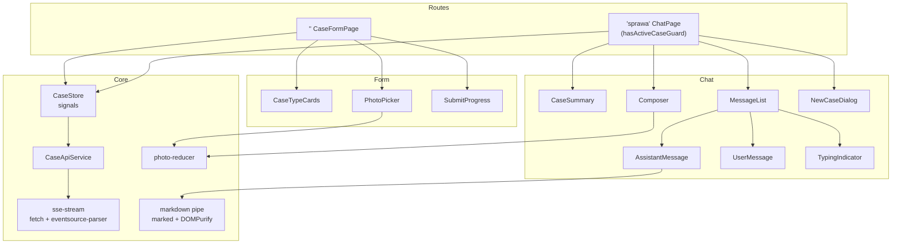

# ADR-003: Frontend — Angular 22, Angular Material, Chat UI and SSE Client

**Date:** 2026-11-25
**Status:** Accepted
**Relates to:** [`000-main-architecture.md`](000-main-architecture.md), [`002-backend.md`](002-backend.md), [`docs/design-guidelines.md`](../design-guidelines.md)

---

## 1. Scope

**Covers:**
- Angular and Angular Material initialization.
- Theming to the brand.
- Application structure and state.
- The case form (PRD §9.1) and the decision chat (PRD §9.2).
- The choice between a ready-made chat library and building our own.
- Consuming SSE from POST endpoints.
- Markdown rendering.
- Photo reduction.
- Integration with Spring Boot in development and in the JAR.
- Frontend and E2E tests.

**Does not cover** backend contracts (ADR-002 §5 is authoritative) or the AI behavior (ADR-001).

---

## 2. Technology Documentation References

| Library | Version (npm, 2026-11-25) | Context7 ID or official docs | Used for |
|---|---|---|---|
| `@angular/core`, `@angular/cli`, `@angular/build` | 22.3.0 | `/angular/angular-cli/v22.2.2`, `/websites/angular_dev`; https://angular.dev/cli/new, https://angular.dev/guide/zoneless | Framework, CLI, build, dev server |
| `@angular/material`, `@angular/cdk` | 22.3.0 | `/angular/material2-docs-content` | Components, M3 theming, harnesses, `TextFieldModule`, `LiveAnnouncer` |
| `@angular/material-date-fns-adapter`, `date-fns` | 22.3.0 / current | `/angular/material2-docs-content` (datepicker) | Polish date parsing and formatting with typed input |
| `marked` | 18.3.0 | https://marked.js.org | Markdown → HTML |
| `dompurify` | 3.5.0 | https://github.com/cure53/DOMPurify | HTML sanitization |
| `eventsource-parser` | 4.1.3 | https://github.com/rexxars/eventsource-parser | SSE parsing of a `fetch` body stream |
| `vitest` (via `@angular/build:unit-test`) | 5.1.2 | https://angular.dev/guide/testing | Unit and component tests |
| `@playwright/test` | 1.65.1 | https://playwright.dev | E2E |
| Evaluated, not adopted | — | `/ovidijusparsiunas/deep-chat`, `/websites/ai-sdk_dev`, `/jfcere/ngx-markdown` | See §6 D-F2, D-F4 |

---

## 3. Component Design

### 3.1 Initialization

Run these from the repository root, with Node 24 and npm 11 (already on the VM):

| Step | Command | Effect |
|---|---|---|
| 1 | `npx @angular/cli@22 new frontend --directory app/frontend --style=scss --routing --ssr=false --zoneless --skip-git --package-manager=npm --ai-config=none` | Standalone (default), strict (default), **zoneless** (default since v21, passed explicitly), Vitest test runner (default), no SSR, no nested git repo. `--ai-config=none` because the repository already has `AGENTS.md`/`CLAUDE.md` |
| 2 | `cd app/frontend && npx ng add @angular/material` | Choose a **custom theme** and **no Roboto** typography (Montserrat replaces it, §3.2). The schematic adds Material Symbols and global body styles |
| 3 | `npm i @angular/material-date-fns-adapter date-fns` | Date adapter for the `pl` locale (no `ng add` schematic is assumed) |
| 4 | `npm i marked dompurify eventsource-parser` | Markdown, sanitizing, SSE parsing |
| 5 | `npx ng generate @angular/material:theme-color` | Generate the M3 palettes from primary `#001D4C` and tertiary `#FF9700` into `src/_theme-colors.scss` |
| 6 | Create `src/proxy.conf.json` mapping `/api/**` to `http://localhost:8080` (`secure: false`), referenced from `angular.json` → `serve.options.proxyConfig` | Same-origin API in development (D-01) |
| 7 | Set `angular.json` → `build.options.outputPath` to `dist/frontend` (keeps the default `browser` subfolder) | The Maven build copies `dist/frontend/browser` (ADR-002 §3.8) |
| 8 | Add `public/favicon.ico` and `public/logo.webp` from `assets/` | Brand assets. They exist only after the design-system PR (#2) is merged into the base branch |
| 8a | In `app/e2e`: `npm i -D @playwright/test@1.65.1`, then `npx playwright install chromium` | Browser for E2E. `--with-deps` needs `sudo`, so it is not used |
| 9 | Create `app/frontend/AGENTS.md` with the verified commands (`npm start`, `npm test`, `npm run build`), the zoneless + signals rules and the "no hard-coded colors" rule | Scoped agent instructions |

**Scripts in `package.json`:**
- `start` runs `ng serve` (with the proxy).
- `build` runs `ng build`.
- `test` runs `ng test`; CI uses `--no-watch`.
- `lint` runs `ng lint`, after `ng add angular-eslint`.

### 3.2 Theming (Material 3 → brand tokens)

The tokens come from `assets/design-tokens.json` and `docs/design-guidelines.md`.

- **Theme mixin:**
  - `html { @include mat.theme((color: (primary: <generated navy palette>, tertiary: <generated orange palette>, theme-type: light), typography: (plain-family: Montserrat, brand-family: Montserrat, bold-weight: 700, medium-weight: 500, regular-weight: 400), density: 0)); }`
  - This is described in prose; the exact mixin API is in Context7 `/angular/material2-docs-content`, guides/theming.
- **Exact brand colors:** M3 tonal palettes do not reproduce exact hex values. After `mat.theme`, override the system tokens with `mat.theme-overrides`:

  | System token | Value | Role |
  |---|---|---|
  | `primary` | `#001D4C` | Navy |
  | `on-primary` | `#FFFFFF` | Text on navy |
  | `tertiary` | `#FF9700` | Orange |
  | `on-tertiary` | `#FFFFFF` | Text on orange |
  | `surface` | `#FFFFFF` | Default surface |
  | `surface-container-low` | `#F4F7FC` | Section background (`background.light`) |
  | `on-surface-variant` | `#60708B` | Secondary text |
  | `outline-variant` | `#BDBDBD` | Borders |
  | `error` | `#D32F2F` | Errors |

- **Shapes:** every corner token used by buttons, cards, dialogs and form fields gets 8 px, through component overrides such as `mat.button-overrides`, `mat.card-overrides` and `mat.dialog-overrides`.
- **CTA buttons:**
  - The primary CTA ("Wyślij zgłoszenie") is a filled button in **tertiary/orange**, padding `10px 40px`, height 48 px, no uppercase.
  - Secondary buttons (Aplikuj-style: "Nowa sprawa", send) are filled **primary/navy**.
- **Font:** Montserrat with weights 100–700 and the `latin-ext` subset for Polish diacritics. Use the `@fontsource/montserrat` npm package (SIL OFL), self-hosted so the JAR works offline, rather than Google Fonts.
- **Tokens in component styles:** component SCSS uses only `var(--mat-sys-*)` tokens plus a small set of app CSS variables (`--app-badge-*`). No hex literals outside `styles/_tokens.scss`.
- **Decision badge colors** (`--app-badge-*`, all with text contrast ≥ 4.5:1):

  | Decision | Badge background | Text |
  |---|---|---|
  | Wstępnie przyjęte | `#2E7D32` | white |
  | Odrzucone | `#D32F2F` | white |
  | Potrzebne dodatkowe informacje | `#FF9700` | navy `#001D4C` |
  | Przekazane do specjalisty | `#001D4C` | white |

- **Header (app shell):**
  - Full-width bar with background `#0D244C` (`brand.header`, exposed as `--app-header-bg`).
  - `logo.webp` at the left at 178×45 px, with ≥ 16 px clear space. The logo is the white wordmark and **must only be placed on navy**, never on the white surface.
  - Next to it, the product name "Hardware Service Decision Copilot" and the subtitle (§3.7) in white.
  - It is implemented in the root `app.ts` / `app.html` / `app.scss`. The mobile layout follows `assets/homepage-mobile.png`, without the overlap bug noted in the design guidelines.
- **Contrast note:** the brand's white-on-orange (`#FFFFFF` on `#FF9700`) is about 2.2:1, which is below WCAG AA for 16 px text. The brand reference uses it for CTAs. The ADR keeps the brand look, and this is recorded as open question Q-F1.

### 3.3 Application structure (`app/frontend/src/app`)

| Path | Type | Responsibility |
|---|---|---|
| `app.config.ts` | Providers | `provideRouter`, `provideHttpClient(withFetch())`, `provideDateFnsAdapter` with `pl`, `MAT_DATE_LOCALE` = the date-fns `pl` locale object, `LOCALE_ID='pl'` + `registerLocaleData(localePl)`, `MAT_FORM_FIELD_DEFAULT_OPTIONS` (appearance `outline`) |
| `app.routes.ts` | Routes | `''` → `CaseFormPage`; `'sprawa'` → `ChatPage` with `hasActiveCaseGuard` (redirects to `''` if no case is in memory, which covers AC-43 after reload); `'**'` → `''` |
| `core/api/case-api.service.ts` | Service | Builds multipart bodies. `purchaseDate` is serialized as a **local** calendar date with `format(date, 'yyyy-MM-dd')` (date-fns), never with `JSON.stringify(Date)`, which would shift it to the previous day in UTC. `createCase()` and `sendMessage()` return a stream handle (§3.5); `deleteCase()` uses `HttpClient` |
| `core/sse/sse-stream.ts` | Function | `fetch` POST → `TextDecoderStream` → `EventSourceParserStream` → typed `CopilotEvent` callbacks, with an `AbortController` |
| `core/state/case.store.ts` | Signal store (injectable service) | `caseId`, `form`, `formPhoto` (object URL), `decision`, `messages`, `streaming`, `additionalPhotoCount` (incremented on `done` of a turn that carried a photo, never on send); `computed` `canAttachPhoto`, `canSend` |
| `core/image/photo-reducer.ts` | Function | Validates the original file (AC-09/10), then `createImageBitmap(file, {imageOrientation:'from-image'})`, scales the longest edge to ≤1568 px (the Jev 1.14 triage limit, ADR-000 D-06) on an `OffscreenCanvas` (fallback `<canvas>`), and `convertToBlob('image/jpeg', 0.85)` |
| `core/markdown/markdown.pipe.ts` | Pure pipe | `marked.parse` → `DOMPurify.sanitize` (allow-list: `p, h3, h4, ul, ol, li, strong, em, br, code`) → `SafeHtml` |
| `features/case-form/case-form.page.ts` | Page | The form (§3.4), loading steps, submit error banner |
| `features/case-form/case-type-cards.component.ts` | Component | Two large selectable cards built on `mat-radio-group` (radio semantics, keyboard arrows) |
| `features/case-form/photo-picker.component.ts` | Component | Drop zone + "Wybierz zdjęcie" button (`<input type=file accept="image/jpeg,image/png,image/webp">`, **without** `capture`, so mobile browsers offer both the camera and the gallery), per-type hint (AC-12), thumbnail + file name + "Usuń" (AC-11) |
| `features/case-form/submit-progress.component.ts` | Component | Steps "Przesyłam zdjęcie", "Analizuję zdjęcie", "Przygotowuję decyzję", with the current step highlighted from `progress` events |
| `features/chat/chat.page.ts` | Page | Layout: `mat-sidenav-container` on ≥ 960 px (summary `mode="side"`); below that, a `mat-expansion-panel` "Szczegóły sprawy" above the chat |
| `features/chat/case-summary.component.ts` | Component | Case type, category, model, date, thumbnail (click → `MatDialog` enlarged view), current decision badge, "Nowa sprawa" |
| `features/chat/message-list.component.ts` | Component | Scroll container (`CdkScrollable`), message bubbles, auto-scroll (AC-39) |
| `features/chat/assistant-message.component.ts` | Component | Segments in the order of ADR-001 §3.5: safety block, decision-change block, greeting, badge, markdown body, disclaimer, inline error + "Spróbuj ponownie" |
| `features/chat/user-message.component.ts` | Component | Text, photo thumbnail, time, failed state with retry (AC-41) |
| `features/chat/composer.component.ts` | Component | `textarea` with `cdkTextareaAutosize`; Enter sends, Shift+Enter adds a new line; attach button disabled at the limit with a hint (AC-33); photo preview with remove; counter /2000 |
| `features/chat/typing-indicator.component.ts` | Component | Three animated dots + visually hidden "Asystent pisze…" |
| `features/chat/new-case-dialog.component.ts` | Dialog | Text from PRD §9.3; "Anuluj" focused by default (`cdkFocusInitial`) |
| `shared/decision-badge.component.ts` | Component | Label → Polish text + color (§3.2) |
| `shared/texts.pl.json` + `shared/texts.pl.ts` | Constants | **All** fixed Polish strings, exactly as listed in §3.7. The JSON is the single source, also read by the backend test (ADR-002 §3.6). The TS file imports it with typed keys |

**State flow:** signals only, with no NgRx. RxJS is used only where `HttpClient` returns observables. Zoneless change detection renders on signal writes.

### 3.4 Case form behavior

| Control | Material component | Rules |
|---|---|---|
| Case type | `mat-radio-group` rendered as two cards | Required; no default (AC-02); changes the reason's required marker and validator and the photo hint |
| Category | `mat-select` | 9 options in AC-03 order; no default |
| Name/model | `matInput` | Trim; 2–100; placeholder "np. Galaxy S23, ThinkPad T14" |
| Purchase date | `matInput` + `mat-datepicker` (date-fns `pl`, parse formats `dd.MM.yyyy`, `d.M.yyyy`, `yyyy-MM-dd`) | `max` = today, `min` = today − 10 years. The custom validators emit the exact AC-05 messages; typing is allowed |
| Reason | `textarea matInput` + `mat-hint align="end"` counter `n/2000` | Required, ≥ 20 trimmed characters for a complaint (AC-06/07); `maxlength` 2000 |
| Photo | `photo-picker` | Single file; replacement on a new pick (AC-08); type and size errors before upload (AC-09/10) |
| Submit | Filled tertiary button "Wyślij zgłoszenie" | Always enabled while idle. On click: `markAllAsTouched`; if invalid, focus the first invalid control (AC-13); if valid, disable the form and show progress (AC-14) |

- **Forms API:** Angular **Reactive Forms** (`FormGroup`/`FormControl`, typed). Signal Forms were not evaluated in this research, so they are not adopted.
- **Errors:**
  - Controls use the default `updateOn: 'change'`, so the counter and the type-dependent revalidation stay live.
  - `mat-error` messages appear after the field is touched (blur), through Material's default `ErrorStateMatcher`, and for all fields on a submit attempt (AC-13).
- **Submit error:** the banner above the button shows "Nie udało się przeanalizować zgłoszenia. Spróbuj ponownie." with "Spróbuj ponownie", which re-sends the stored reduced photo and form (AC-40).

### 3.5 SSE client and chat flow

- **Transport:** native `fetch(url, {method:'POST', body: FormData, signal})`. `EventSource` cannot POST. Angular `HttpClient` progress events repeat the whole accumulated body on each event, which is unsuitable for long streams.
- **Parsing:** `response.body.pipeThrough(new TextDecoderStream()).pipeThrough(new EventSourceParserStream())`. Each parsed event has a `type` matching ADR-000 §6, and its `data` is parsed as JSON. Verify the exact `EventSourceParserStream` export name in the `eventsource-parser` README during implementation.
- **Pre-stream errors:** a non-2xx `response.ok=false` before the stream starts is read as a JSON `ApiError` and mapped as in the §3.7 error table.
- **Watchdog (AC-40):** if no `decision` event arrives within **60 s** of the request start, the client aborts the stream (`AbortController`) and treats it as `TIMEOUT`.
- **Mapping into `CaseStore`:**

  | Event | Store update |
  |---|---|
  | `case` | Set `caseId` |
  | `progress` | Set the current step |
  | `decision` | Create the assistant message shell with its segments and update the summary badge (AC-35/36), **keeping the previous `DecisionView` in the store** until `done`. On the first submit, navigate to `/sprawa` |
  | `delta` | Append to the message body (the markdown re-renders, throttled to one render per animation frame) |
  | `done` | Mark the message complete and re-enable send (AC-38) |
  | `error` | **First submit, before `decision`:** stay on the form with the banner. **First submit, after `decision`** (already on `/sprawa`):<br>1. Navigate back to `''`.<br>2. Restore the form values and the reduced photo kept in the store.<br>3. Clear `caseId` and the messages; the backend has stored nothing.<br>4. Show the banner (AC-40).<br>**Chat:** show the inline error on the user's message, discard the partial assistant message, and **restore the previous `DecisionView`** in the summary badge, because the server committed nothing (AC-30, AC-36) |

- **Typing indicator:** shown from send until the first `delta` (AC-37).
- **Retry (AC-41):** the user message keeps its `clientMessageId`, text and reduced photo blob, and "Spróbuj ponownie" re-POSTs them. If the server had already committed the turn, it **replays** it (ADR-002 §3.4), and the store treats the replay like a normal reply.
- **Auto-scroll (AC-39):**
  - Follow the newest content only while the user is within 80 px of the bottom.
  - Otherwise show a "Nowe wiadomości ↓" button.
  - Announce message completion through `LiveAnnouncer` (polite).
- **Leaving the page (AC-43):** a `beforeunload` listener is active while `caseId` is set.
- **New case (AC-44):** "Nowa sprawa" opens the dialog. On confirm: `deleteCase` (fire and forget), abort any stream, reset the store and navigate to `''`.

### 3.6 Markdown rendering during streaming

- The assistant body is re-parsed from the full accumulated text at most once per animation frame. Chat messages are small, about 250 words.
- Temporary rendering artifacts from unclosed `**` or lists are accepted.
- Raw HTML from the model is never trusted. DOMPurify uses the allow-list in §3.3, and Angular's sanitizer applies on `[innerHTML]` as a second layer.
- Links are not rendered as anchors. The allow-list excludes `a`, because the agent must not send URLs not present in the policy.

### 3.7 Polish UI texts and error handling (single source)

**Texts.** `shared/texts.pl.json` (imported by `texts.pl.ts`) contains exactly these strings.
- PRD texts are quoted verbatim (marked **PRD**). The others were defined here on 2026-11-26.
- The backend uses the same validation texts (ADR-002 §3.6).

| Key | Text |
|---|---|
| `app.title` | Hardware Service Decision Copilot |
| `app.subtitle` | Sprawdź od razu, czy Twój zwrot lub reklamacja zostaną wstępnie przyjęte. |
| `form.info` | Decyzja jest wstępna i zostanie potwierdzona po oględzinach urządzenia. **PRD** |
| `form.caseType.complaint` / `.complaintDesc` | Reklamacja / Urządzenie jest uszkodzone lub nie działa **PRD** |
| `form.caseType.return` / `.returnDesc` | Zwrot / Urządzenie jest sprawne, chcę je oddać **PRD** |
| `form.caseType.required` | Wybierz typ zgłoszenia. |
| `form.category.required` | Wybierz kategorię sprzętu. |
| `form.model.invalid` | Podaj nazwę lub model urządzenia (2–100 znaków) **PRD** |
| `form.model.placeholder` | np. Galaxy S23, ThinkPad T14 **PRD** |
| `form.purchaseDate.required` | Podaj datę zakupu. |
| `form.purchaseDate.invalid` | Podaj poprawną datę w formacie DD.MM.RRRR. |
| `form.purchaseDate.future` | Data zakupu nie może być w przyszłości **PRD** |
| `form.purchaseDate.tooOld` | Data zakupu jest zbyt odległa **PRD** |
| `form.reason.tooShort` | Opisz problem (min. 20 znaków) **PRD** |
| `form.reason.tooLong` | Opis może mieć maksymalnie 2000 znaków. |
| `form.photo.button` | Wybierz zdjęcie **PRD** |
| `form.photo.required` | Dodaj zdjęcie urządzenia. |
| `form.photo.type` | Dozwolone formaty: JPG, PNG, WebP **PRD** |
| `form.photo.size` | Zdjęcie przekracza limit 10 MB **PRD** |
| `form.photo.decode` | Nie udało się odczytać zdjęcia. Wybierz inny plik. |
| `form.photo.remove` | Usuń **PRD** |
| `form.photo.hint.none` | Wybierz typ zgłoszenia, aby zobaczyć, jak zrobić zdjęcie. |
| `form.photo.hint.return` | Sfotografuj całe urządzenie od przodu. Jeśli ma folię ochronną, niech będzie widoczna. (AC-12) |
| `form.photo.hint.complaint` | Pokaż wyraźnie uszkodzenie lub usterkę – najlepiej z bliska. (AC-12) |
| `form.submit` | Wyślij zgłoszenie **PRD** |
| `form.submitError` | Nie udało się przeanalizować zgłoszenia. Spróbuj ponownie. **PRD** |
| `common.retry` | Spróbuj ponownie **PRD** |
| `progress.UPLOAD_RECEIVED` / `ANALYZING_PHOTO` / `PREPARING_DECISION` | Przesyłam zdjęcie / Analizuję zdjęcie / Przygotowuję decyzję **PRD** |
| `chat.summaryTitle` | Szczegóły sprawy **PRD** |
| `chat.greeting` | Dzień dobry! Oto wstępna ocena Twojego zgłoszenia. |
| `chat.safety` | **Ze względów bezpieczeństwa:** przestań używać urządzenia i nie ładuj go. Odłóż je z dala od materiałów łatwopalnych. Nie otwieraj obudowy i nie próbuj naprawy. |
| `chat.decisionChange` | Zmiana decyzji **PRD** |
| `chat.disclaimer` | Ta decyzja jest wstępna i została przygotowana automatycznie przez asystenta AI. Ostateczną decyzję podejmie zespół serwisu po oględzinach urządzenia. Nie ogranicza to Twoich praw wynikających z przepisów o ochronie konsumentów. **PRD** |
| `label.ACCEPTED_PRELIMINARY` / `REJECTED` / `NEEDS_MORE_INFO` / `ESCALATED` | Wstępnie przyjęte / Odrzucone / Potrzebne dodatkowe informacje / Przekazane do specjalisty **PRD** |
| `chat.typing` | Asystent pisze… |
| `chat.newMessages` | Nowe wiadomości ↓ |
| `chat.message.empty` | Wpisz wiadomość lub dodaj zdjęcie. |
| `chat.message.tooLong` | Wiadomość może mieć maksymalnie 2000 znaków. |
| `chat.photoLimit` | Osiągnięto limit zdjęć w tej sprawie **PRD** |
| `chat.error.generic` | Nie udało się przygotować odpowiedzi. Spróbuj ponownie. |
| `chat.error.busy` | Poprzednia wiadomość jest jeszcze przetwarzana. Spróbuj za chwilę. |
| `chat.error.expired` | Ta sprawa wygasła. Rozpocznij nową sprawę. |
| `common.newCase` | Nowa sprawa **PRD** |
| `dialog.newCase.text` / `.cancel` / `.confirm` | Bieżąca rozmowa zostanie utracona. Kontynuować? / Anuluj / Nowa sprawa **PRD** |

**Error handling** (wire codes from ADR-000 §6 and ADR-002 §3.7):

| Where | Code / situation | UI behavior | Text key |
|---|---|---|---|
| Form submit | 400 `VALIDATION` | Field errors from `fieldErrors`; focus the first invalid field | Per field |
| Form submit | 413 `PAYLOAD_TOO_LARGE` | Error on the photo field | `form.photo.size` |
| Form submit | Stream `AI_UNAVAILABLE`, `TIMEOUT`, watchdog, network failure, 500 | Banner with retry; if already on `/sprawa`, go back as in §3.5 | `form.submitError` |
| Chat | Stream `AI_UNAVAILABLE`, `TIMEOUT`, watchdog, network failure, 500 | Inline error under the user message, with retry | `chat.error.generic` |
| Chat | 409 `CASE_BUSY` | Inline error, with retry | `chat.error.busy` |
| Chat | 404 `CASE_NOT_FOUND` | Inline error plus a "Nowa sprawa" button that resets **without** the confirmation dialog (nothing is left to lose) | `chat.error.expired` |
| Chat | 422 `PHOTO_LIMIT` | Keep the text, remove the photo preview, disable attach with the hint | `chat.photoLimit` |
| Chat | 400 `VALIDATION` | Error under the composer | `chat.message.empty` / `.tooLong` |
| Chat | 413 `PAYLOAD_TOO_LARGE` | Keep the text, remove the photo preview, error under the composer | `form.photo.size` |

---

## 4. Data Structures

| Type | Fields |
|---|---|
| `CaseFormValue` | `caseType: 'RETURN'\|'COMPLAINT'`, `category: CategoryCode`, `model: string`, `purchaseDate: Date` (in the UI; sent as `YYYY-MM-DD` local, §3.3), `reason: string`, `photo: File` |
| `ReducedPhoto` | `blob: Blob` (JPEG), `objectUrl: string`, `originalName: string`, `width`, `height` |
| `DecisionView` | `label`, `previousLabel?`, `changed`, `changeReasonPl?`, `safety`, `suggestOtherCaseType`, `ruleIds` |
| `UiMessage` | `id`, `role: 'user'\|'assistant'`, `text`, `photoUrl?`, `createdAt`, `status: 'sending'\|'streaming'\|'complete'\|'failed'`, `clientMessageId?`, `decision?: DecisionView`, `isFirst: boolean` |
| `CopilotEvent` | Discriminated union over `case`, `progress`, `decision`, `delta`, `done`, `error` with the payloads from ADR-002 §4 |
| `CategoryCode` → label | `SMARTPHONE` Smartfon, `LAPTOP` Laptop, `TABLET` Tablet, `DESKTOP` Komputer stacjonarny, `MONITOR` Monitor, `TV` Telewizor, `AUDIO` Słuchawki / Audio, `WEARABLE` Smartwatch / Opaska, `OTHER` Inne |

---

## 5. Interface Contracts

The frontend consumes exactly the backend contracts in ADR-002 §5. Additional frontend-only contracts:

| Interface | Input | Output | Errors |
|---|---|---|---|
| `reducePhoto(file)` | `File` | `Promise<ReducedPhoto>` | `INVALID_TYPE` (not JPEG/PNG/WebP by MIME and extension), `TOO_LARGE` (> 10 MB), `DECODE_FAILED` |
| `openStream(url, formData, handlers, signal)` | URL, `FormData`, event callbacks | `Promise<void>` that resolves on `done` or `error` | Rejects on network failure → mapped to the generic error |
| `CaseStore.submitCase(form)` / `sendMessage(text, photo?)` / `retry(messageId)` / `reset()` | — | Updates signals | — |

---

## 6. Technical Decisions

### D-F1 Angular 22 standalone + zoneless + signals, initialized with the CLI
**Status:** Accepted · **Date:** 2026-11-25
**Context:** The group selected Angular. On 2026-11-25 the current version is 22.3.0, standalone and zoneless are the defaults, and Vitest is the default runner.
**Decision:** Initialize with the command in §3.1 and use signals for all UI state.
**Rejected alternatives:**
- Zone.js: extra runtime and no longer the default.
- NgRx: unnecessary for two screens and one case.
**Consequences:**
- (+) A current, minimal setup aligned with the official docs.
- (−) Some third-party libraries may still assume Zone.js. None of the selected libraries do.
**Review trigger:** Angular 23 release; adding complex shared state.

### D-F2 Build the chat UI from Angular Material/CDK primitives; no chat library
**Status:** Accepted · **Date:** 2026-11-25
**Context:** The brief asked for ready-to-use chat components and streaming helpers for Angular Material. These candidates were evaluated on 2026-11-25:

| Package | Version / date | Fit | Verdict |
|---|---|---|---|
| `deep-chat` (web component) | 2.5.1 / 2026-08-27, MIT | Streaming (incl. SSE), attachments and markdown, but it is styled through its own JSON style props rather than Material tokens, and it bundles the unmaintained `@microsoft/fetch-event-source` | Rejected: brand and theming drift, and a custom event contract would need adapters |
| `@ai-sdk/angular` | 3.0.181 / 2026-11-23, Apache-2.0 | Signal-based `Chat` state; **no UI components**; it expects the AI SDK UI Message Stream protocol from the backend or a custom transport | Rejected: it would force our Spring backend to emulate a JS-ecosystem protocol for little gain |
| `@copilotkit/angular` | 0.6.0 / 2026-11-20, MIT | Pre-1.0; needs a CopilotKit/AG-UI runtime; heavy dependencies | Rejected |
| `@nebular/theme` (chat) | 17.0.0 / 2026-01-15 | Peer dependency Angular ^21; a separate design system | Rejected: incompatible with Angular 22 |
| Kendo Conversational UI | 26.1.0 | Commercial license | Rejected |
| `ngx-chat-ui` | 0.1.4 / 2019 | Abandoned | Rejected |

**Decision:**
- Build the chat from Material and CDK: `mat-sidenav`, `mat-expansion-panel`, `mat-card` and `mat-chip` for the badge, `MatDialog`, `cdkTextareaAutosize`, `CdkScrollable` and `LiveAnnouncer`.
- Add `marked` + DOMPurify for the body and our own `sse-stream`.
- The estimate is about 300–500 lines.

**Consequences:**
- (+) Exact brand match, full control over the PRD-specific segments (badge, change block, safety, disclaimer) and no protocol coupling.
- (−) We own scroll, a11y and streaming rendering code, which the tests in §8 cover.

**Review trigger:**
- A maintained Material-native chat component appears in `@angular/material` or Angular's AI tooling.
- The UI grows to multi-conversation or tool-call rendering.

### D-F3 `fetch` + `eventsource-parser` for POST SSE
**Status:** Accepted · **Date:** 2026-11-25
**Decision:** §3.5.
**Rejected alternatives:**
- `EventSource`: GET only.
- `@microsoft/fetch-event-source` 2.0.1: last release in 2021, unmaintained.
- `HttpClient` with `observe:'events'` and download progress: `partialText` is cumulative, so it is re-parsed from an offset on every event, and it is clumsy.
- `resource({stream})`: suitable as a wrapper later. It is not used as the transport because cancellation and retry semantics are simpler with a plain function.
**Consequences:**
- (+) A small, maintained, spec-compliant parser; `AbortController` support.
- (−) `HttpClient` interceptors do not apply to these calls. None are needed: there is no authentication.
**Review trigger:** Angular adds first-class streaming to `HttpClient` or `httpResource`.

### D-F4 `marked` + DOMPurify instead of ngx-markdown
**Status:** Accepted · **Date:** 2026-11-25
**Context:** ngx-markdown 22.1.1 supports Angular 22 and sanitizes by default, but it adds a component layer and its own peer dependency (`marked`) range management.
**Decision:** Use a pure pipe with `marked` 18 + DOMPurify 3 and a strict allow-list.
**Consequences:**
- (+) Fewer dependencies and an explicit sanitization policy.
- (−) No syntax highlighting or other extras, which are not needed.
**Review trigger:** Code blocks, tables or math are needed in agent replies.

### D-F5 Montserrat self-hosted via `@fontsource/montserrat`
**Status:** Accepted · **Date:** 2026-11-25
**Decision:** Self-host the font instead of linking Google Fonts, so the JAR works offline in the course VM and no third-party request leaks the user's IP.
**Review trigger:** A CDN font policy is decided by the business.

---

## 7. Diagrams

### Component diagram



### Sequence: first submission in the browser

```mermaid
sequenceDiagram
  actor U as Customer
  participant F as CaseFormPage
  participant R as photo-reducer
  participant S as CaseStore
  participant X as sse-stream
  participant B as Backend
  U->>F: Click "Wyślij zgłoszenie"
  F->>F: markAllAsTouched; invalid → focus the first invalid field
  F->>R: reducePhoto(file) (already done on pick, cached)
  F->>S: submitCase(form, reducedPhoto)
  S->>X: openStream(POST /api/cases, FormData)
  X->>B: fetch
  B-->>X: case, progress...
  X-->>S: set caseId, step
  S-->>F: SubmitProgress highlights the step
  B-->>X: decision
  X-->>S: create the assistant shell + badge
  S-->>F: navigate to /sprawa
  B-->>X: delta...
  X-->>S: append body (rAF-throttled render)
  B-->>X: done
  X-->>S: complete, send enabled
```

### Sequence: chat message with photo, failure and retry

```mermaid
sequenceDiagram
  actor U as Customer
  participant C as Composer
  participant S as CaseStore
  participant X as sse-stream
  participant B as Backend
  U->>C: Attach photo + type text + Enter
  C->>S: sendMessage(text, reducedPhoto)
  S->>S: Add the user message (sending), typing indicator, disable send
  S->>X: POST /api/cases/{id}/messages (clientMessageId)
  B-->>X: progress, then error{AI_UNAVAILABLE}
  X-->>S: Mark the user message failed, hide typing
  U->>S: Click "Spróbuj ponownie"
  S->>X: Same clientMessageId, text and photo
  B-->>X: decision{changed:true, previousLabel}
  X-->>S: Update the summary badge; the assistant message starts with the "Zmiana decyzji" block
  B-->>X: delta..., done
```

---

## 8. Testing Strategy

### Test scenarios for this area

| Scenario | Type | Input | Expected output | Edge cases |
|---|---|---|---|---|
| Field order and options | Component (Vitest + harnesses) | Render the form | Field order per AC-01; 2 types, 9 categories, nothing preselected (AC-02/03) | — |
| Validation messages | Component | Blur each field with invalid values; submit an empty form | Exact Polish messages; focus moves to the first invalid field (AC-13) | Reason required marker toggles with the case type (AC-06) |
| Date parsing | Unit | Typed `24.11.2026`, `2026-11-24`, `31.02.2026` | The first two are parsed; the third is invalid | Today, tomorrow, 10 years ago |
| Photo reducer | Unit (jsdom with canvas mocks) + browser test | **Real example photos:** `laptop-1.png` (3024×3135, JPEG content with a `.png` name), `laptop-2.webp`, `phone-2.jpeg` (small). **Byte-level fixtures (PRD §12 exception):** GIF/HEIC headers, an in-memory blob > 10 MB | Large photos → ≤1568 px JPEG; small photo not upscaled; WebP accepted; GIF/HEIC and > 10 MB rejected with the §3.7 texts | EXIF orientation is **not covered** until a real rotated photo is added to `assets/example-images/` |
| Chat error after `decision` | Unit (store) | `decision{changed:true}` → `delta` → `error` in a chat turn | Badge back to the previous label, partial message removed, inline error shown | — |
| SSE parser | Unit | **Recorded backend SSE transcripts** (`src/testing/captures/*.sse`, recorded from the running app with real OpenRouter in plan T26/T27), re-chunked at varying byte boundaries incl. mid-line and inside multi-byte Polish characters | Correct typed events in order; `: ping` comments ignored | A recording truncated before `done` → error |
| Store transitions | Unit | Recorded transcripts. Sequences that cannot be provoked for real (e.g. `error` after `delta`) are **spliced from recorded events**: real `decision`/`delta` events from a success recording plus the real `error` event from the invalid-key recording, in an order ADR-002 §3.5 allows. No event payload is hand-written | Signals match the expected state (badge, messages, streaming) | `error` after deltas → failed state, partial text discarded |
| HTTP error mapping input | Unit | **Recorded real backend error responses** (400, 404, 409, 413, 422), captured in plan T27 by sending real invalid requests to the running app | Each maps to the §3.7 behavior | — |
| Markdown sanitization | Unit | `<script>`, ``, `[link](javascript:)` in the body | Removed; headings, lists and bold kept | Unclosed `**` while streaming |
| Composer keys | Component | Enter, Shift+Enter, empty text, 2001 chars | Send, newline, blocked, blocked | Photo without text allowed (AC-32) |
| Photo limit | Component | `additionalPhotoCount=3` | Attach disabled + hint (AC-33) | — |
| Date serialization | Unit | Date picked as 24.11.2026 with the clock at 00:30 CET | Request body has `purchaseDate=2026-11-24` | Leap day |
| First-submit error after `decision` | Unit (store) | Events `decision`, `delta`, `error` on the first submit | Back on `''`, form and photo restored, banner shown, `caseId` cleared | Watchdog at 60 s without `decision` |
| Error mapping | Unit (store) | Each row of the §3.7 error table | The documented behavior and text key | 404 → reset without the dialog |
| Auto-scroll | Component | Scroll up, then deltas arrive | No jump; "Nowe wiadomości" button shown | At bottom → follows |
| New-case dialog | Component (`MatDialogHarness`) | Click "Nowa sprawa" | Exact text; "Anuluj" focused; confirm resets | Escape = cancel |
| Guard | Unit | Navigate to `/sprawa` with no case | Redirect to `''` | — |
| E2E happy path | E2E (Playwright, real JAR + real OpenRouter) | Fill RETURN with `assets/example-images/phone-1.jpg`, recent date | Chat shows greeting, badge, three sections, disclaimer; summary panel correct | 360 px and 1280 px viewports; no console errors |
| E2E complaint + follow-up | E2E | COMPLAINT with `laptop-1.png`, then ask "Jaką datę zakupu podałem?" | The reply contains the form date (AC-34) | Attach a new photo |
| E2E outside window | E2E | RETURN, purchase 45 days ago | Badge ∈ {"Odrzucone", "Przekazane do specjalisty"}. If "Odrzucone", the text mentions 45 and 30; if escalated, the safety block is shown (G1 precedence; the photo content is never pre-assumed) | — |
| E2E error UI | E2E | Backend started with an invalid key | Form banner with "Spróbuj ponownie"; data and photo preserved (AC-40) | — |
| E2E keyboard | E2E | Complete the flow with the keyboard only | All controls reachable, with visible focus and labels (AC-47) | — |
| E2E safety wording | E2E | RETURN, recent date, reason "Bateria spuchła i czuć swąd" | Badge "Przekazane do specjalisty"; the safety block is first (AC-26). Form-driven, via G1 | — |
| E2E chat photo + new case | E2E | In chat, attach `laptop-2.webp` with a question, then "Nowa sprawa" → confirm | Reply streamed; network log shows `POST /messages` with a photo part and then `DELETE /api/cases/{id}` → 204; the form is empty | — |
| E2E coverage proof | E2E (global teardown) | Browser network logs + the backend log file of the JAR run | Every endpoint was called at least once, and the `ai.call` lines show `TRIAGE`, `VISION` (form and chat), `DECISION` and `STREAM` with `status=OK` (ADR-000 §10). Missing evidence fails the run | `DECISION_REASK` reported as observed / not observed |
| Visual QA | Manual (Playwright CLI) | Screenshots of the form and chat at 390 px and 1280 px | Match the brand reference `assets/homepage*.png` + tokens | — |

### Technical acceptance criteria
- TAC-003-01: `npm test -- --no-watch` and `npm run build` pass with zero errors and zero new warnings. The production bundle contains no API key or model name.
- TAC-003-02: No component SCSS file contains hex color literals. Colors come from `--mat-sys-*` or `--app-*` variables (checked by a lint rule or a grep test).
- TAC-003-03: Every user-visible Polish string lives in `shared/texts.pl.json`, and the disclaimer equals the PRD §11 text character for character (asserted in a unit test).
- TAC-003-04: When rendering a 250-word streamed message in 200 deltas, the main thread is never blocked for more than 50 ms (checked in a Playwright performance trace during manual QA).
- TAC-003-05: Pages have no horizontal scrollbar at 360, 390, 768, 1280 and 1920 px widths (Playwright assertion on `scrollWidth <= clientWidth`).

### Open questions
- **Q-F1:** The brand's white text on orange `#FF9700` CTAs is about 2.2:1 contrast, below WCAG AA. Keep it for brand fidelity, or switch the CTA text to navy (about 7.6:1)? Product owner to decide. The implementation follows the brand until then.
