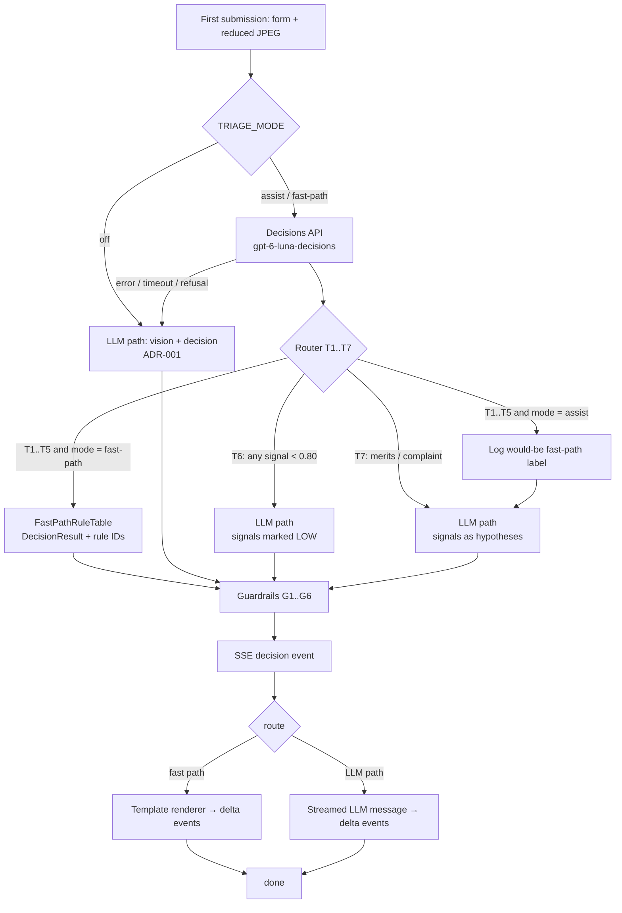
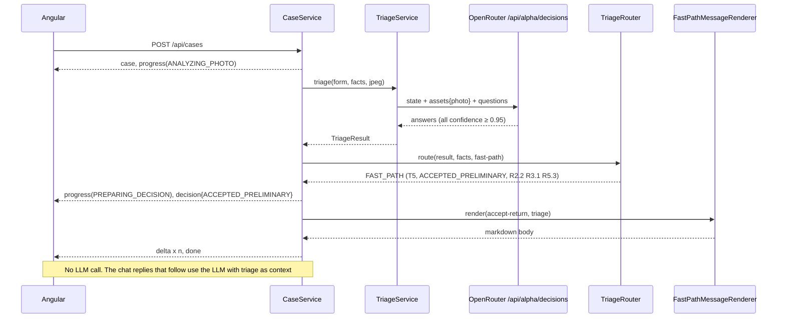
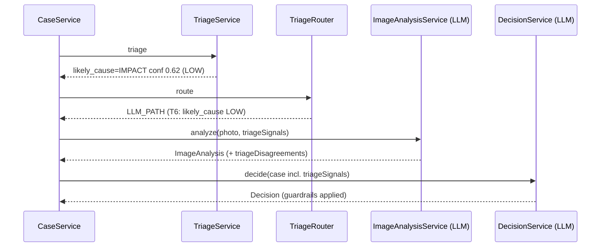

# ADR-004: Photo Triage with a Decisions Model and a Confidence-Based Fast Path

**Date:** 2026-11-25
**Status:** Accepted (implementation gated by spike S-2)
**Relates to:** [`000-main-architecture.md`](000-main-architecture.md), [`001-llm-integration.md`](001-llm-integration.md), [`002-backend.md`](002-backend.md)

---

## 1. Scope

This ADR adds a **triage stage** before the multimodal LLM. The stage uses a *decisions* model, `openai/gpt-6-luna-decisions` on OpenRouter, which answers typed questions about the photo and form data with a probability per option and a confidence score. Its answers are used in three ways:

1. **Signals for the LLM.** The triage answers, with their confidence, are passed to the vision and decision LLM calls (ADR-001) as pre-computed signals to verify. Answers below 80% confidence are explicitly marked as uncertain.
2. **Fast path.** When every answer that a decision depends on has very high confidence (≥ 95%, configurable) and the outcome is in the allowed fast-path set (§3.5), the first decision is produced **without any LLM call**. The first message is rendered from templates, and the LLM is used only in the subsequent chat.
3. **Experiment.** In `assist` mode the fast-path outcome is computed for every case and logged next to the LLM outcome. This gives the data to judge whether the decisions model is good enough for the fast path before it is switched on.

**Out of scope:** the chat stage keeps using the LLM for every reply (ADR-001). This ADR covers neither UI changes beyond rendering templated messages, which use the same segments as LLM messages, nor persistence.

---

## 2. Technology Documentation References

| Item | Source | Verified facts (2026-11-25) |
|---|---|---|
| OpenRouter Decisions API | https://openrouter.ai/docs/api/api-reference/alphadecisions/submit-a-decisions-request.md; SDK listing https://openrouter.ai/docs/client-sdks/typescript/sdks/decisions/README.md | `POST /api/alpha/decisions`. "Alpha: the shape may change." Request requires `model`, `state` and `questions`; optional fields are `assets`, `provider`, `session_id`, `trace` and `user`. Question types: `noul` (yes/no, with `criteria.false`/`criteria.true`), `choice` (criteria map of option to description), `score` (ordered labels) and `box` (TypeSafe endpoints only). Response: `answers[key]` with the value, `probabilities` (choice/score) and `confidence`, plus `usage.cost` in credits. Images go in `state` as `image_url` parts, or once in `assets` as PNG/JPEG standard base64 without a `data:` prefix. No `stream` field. Errors: 400, 401, 402, 403, 404, 413, 429, 500, 502, 503, 524, 529 |
| `openai/gpt-6-luna-decisions` | https://openrouter.ai/openai (provider model list) | **Only the slug is listed.** The model page (`/openai/gpt-6-luna-decisions`) and its `llms.txt` return 404. Description, image support, pricing and the endpoint it is served on are **not verified** |
| OpenRouter "decisions" output modality | https://openrouter.ai/models | "decisions: 39 models". Example decision models (Baseten Groundhog 1, Bison 1) take "text, image -> decisions" and return "a calibrated probability for every option in a single forward pass, with no text generation". No Luna model is described there |
| Spring `RestClient` | `/spring-projects/spring-framework/v7.0.5` | HTTP client for the Decisions endpoint. The OpenAI Java SDK has no method for this OpenRouter-specific alpha endpoint |

> **Unverified assumption:** `gpt-6-luna-decisions` is served on `/api/alpha/decisions` and accepts JPEG images, and its `confidence` is usable as a probability of being correct. Spike S-2 (§6, D-T1) must confirm all three before production code is written.

---

## 3. Component Design

### 3.1 Position in the pipeline

```
photo + form → [TRIAGE: decisions model] → router ─┬─ fast path → rule table → guardrails → templated first message
                                                   └─ LLM path → vision LLM (+triage signals) → decision LLM (+signals) → guardrails → streamed message
```

- Triage runs **only for the first decision** in `assist` and `fast-path` modes. It also runs for photos added in chat, where it only provides signals (no fast path).
- Deterministic guardrails (ADR-001 §3.4, G1–G6) apply to **both** paths.

### 3.2 Components (package `com.hsdc.copilot.triage`)

| Component | Responsibility |
|---|---|
| `TriageProperties` | `mode` (`off \| assist \| fast-path`, default `assist`), `model` (`LLM_TRIAGE_MODEL`, default `openai/gpt-6-luna-decisions`), `lowConfidence` (default 0.80), `highConfidence` (default 0.95), `safetyProbability` (default 0.30), `timeout` (default 10 s), `baseUrl` (default `https://openrouter.ai/api/alpha/decisions`) |
| `DecisionsApiClient` | The only class that knows the alpha wire format. It uses Spring `RestClient` with a bearer `OPENROUTER_API_KEY`, the attribution headers and a 10 s timeout, and makes no retries (the budget is too small). It maps HTTP errors and `refusal` answers to `TriageUnavailable` |
| `TriageQuestionSet` | Builds the questions per case type from `classpath:triage/questions-return.json` and `questions-complaint.json` (versioned files, reviewed like prompts) |
| `TriageService` | Builds `state` (form facts + photo reference), calls the client and maps the answers to `TriageResult` |
| `TriageRouter` | Decides `FAST_PATH` or `LLM_PATH` from `TriageResult`, `CaseFacts` and the mode (§3.5) |
| `FastPathRuleTable` | Pure mapping from high-confidence triage answers to a `DecisionResult` with rule IDs (§3.5). The rule IDs are validated against `PolicyRepository` at startup |
| `FastPathMessageRenderer` | Fills Polish Markdown templates (`classpath:templates/fast-path/*.md`) for the three sections "Co widzimy na zdjęciu", "Uzasadnienie" and "Kolejne kroki". No LLM is involved |
| `TriageAgreementLogger` | In `assist` mode, logs `{caseId, fastPathEligible, fastPathLabel, llmLabel, agree, perQuestionConfidence}` as one structured line per case. Logs are the only sink in the PoC, with no customer text and no image |

### 3.3 Triage questions

State sent to the model:
- a JSON object with `caseType`, `formCategory`, `model`, `daysSincePurchase`, `reason` (customer text);
- the photo as one JPEG asset referenced as `photo`. The browser already re-encodes every photo to JPEG (ADR-000 D-06), which satisfies the "PNG or JPEG" asset constraint.

| Key | Type | Options / labels | Used for | Case types |
|---|---|---|---|---|
| `photo_usable` | noul | true: sharp, well lit, the device is clearly visible; false: blurry, dark, cropped or no device | AC-18/19 | both |
| `device_category` | choice | The 9 form categories (AC-03) + `NOT_A_DEVICE` | Category match: answer = `formCategory` | both |
| `damage_visible` | noul | true: cracks, dents, broken parts, liquid marks, burn marks; false: none visible | AC-16/17 | both |
| `condition` | score | `NEW_UNUSED`, `LIGHT_SIGNS_OF_USE`, `HEAVY_WEAR`, `DAMAGED` | R3.1/R3.3/R3.4 | both |
| `protective_film_visible` | noul | — | R3.1 | RETURN |
| `damage_type` | choice | `NONE`, `SCREEN_CRACK`, `IMPACT_DENT`, `BROKEN_PART`, `LIQUID`, `BURN_OR_SWELLING`, `COSMETIC_WEAR`, `DISPLAY_DEFECT`, `OTHER` | C3/C4 signal | COMPLAINT |
| `likely_cause` | choice | `MANUFACTURING_DEFECT`, `IMPACT`, `LIQUID`, `WEAR`, `UNKNOWN` | AC-17, C3/C4 | COMPLAINT |
| `safety_hazard` | noul | true: swollen battery, burn marks, smoke, sparks, exposed wiring | AC-26, C7.1 | both |
| `description_consistent` | noul | true: the photo is consistent with the customer's reason; false: it contradicts it | R6/C8 contradiction | both (only when `reason` is non-empty) |

The question texts are English instructions, and they tell the model to ignore any instructions found in the photo or the reason (ADR-001 D-L5).

### 3.4 Signals passed to the LLM path

`TriageResult` is serialized into the **CASE FACTS** input item (ADR-001 §3.3) as `triageSignals`. Each question contributes:
- `answer`
- `confidence`
- `band`: `HIGH` (≥ 0.95), `MEDIUM` (0.80–0.95) or `LOW` (< 0.80)

The vision and decision prompts (`vision-*.md`, `decision-*.md`) gain one instruction block:
- treat triage signals as hypotheses to verify;
- `LOW` band signals must be independently re-checked;
- when the LLM disagrees with a `HIGH` band signal, it states so in `ImageAnalysis.triageDisagreements` (a new optional list field).

These disagreements are logged and feed the evals.

### 3.5 Router and fast-path rules

The router takes the **first** matching row. "All ≥ H" means every listed question's confidence is ≥ `highConfidence`.

| # | Mode | Condition | Route | Result |
|---|---|---|---|---|
| T0 | any | `mode=off`, or triage failed or timed out, or `refusal` on any listed question | LLM path, with no signals or partial signals | — |
| T1 | any | G2/G3 time window exceeded (code, ADR-001) | fast path (in `fast-path` mode) | `REJECTED` with `R2.3` / `C2.3`; message template `window-*.md` (AC-24/25) |
| T2 | any | `safety_hazard` P(true) ≥ `safetyProbability` (0.30), at any confidence | fast path (in `fast-path` mode) | `ESCALATED`, `safety=true`, `C7.1`/`R6` (AC-26). This rule is deliberately asymmetric: safety never needs high confidence |
| T3 | fast-path | `photo_usable=false`, all ≥ H on `photo_usable` | fast path | `NEEDS_MORE_INFO`; the template names what the photo must show (AC-19) |
| T4 | fast-path | `device_category` ≠ `formCategory` (or `NOT_A_DEVICE`), all ≥ H on `photo_usable` and `device_category` | fast path | `NEEDS_MORE_INFO`, category-mismatch template (AC-19) |
| T5 | fast-path | RETURN; `photo_usable=true`, category matches, `damage_visible=false`, `condition ∈ {NEW_UNUSED, LIGHT_SIGNS_OF_USE}`, `safety_hazard=false`, `description_consistent≠false`, all ≥ H; `formCategory ∉ {AUDIO, OTHER}` (R4.1 hygiene seal, R6) | fast path | `ACCEPTED_PRELIMINARY` with `R2.2, R3.1, R5.3` (NEW_UNUSED) or `R2.2, R3.3, R5.3` (LIGHT_SIGNS_OF_USE: the template states that a reduction is possible) |
| T6 | any | Any decision-relevant question with confidence < `lowConfidence` (0.80) | LLM path, signals marked `LOW` | — |
| T7 | any | Everything else, including all **rejections by condition/cause** and all **complaint acceptances or rejections** | LLM path | — |

Rejections based on photo interpretation (R3.4, C4) and every complaint merits decision always go to the LLM. A wrong automatic rejection is the costliest error for the customer (PRD P2), and AC-27 already forbids rejecting on uncertain causes.

- **`assist` mode:** T1–T5 are evaluated but never taken. The would-be fast-path label is logged against the LLM label.
- **`fast-path` mode:** T1–T5 are taken.

### 3.6 Fast-path first message

The message has the same segments as LLM messages (ADR-001 §3.5): safety block, greeting, badge, body and disclaimer. The body is rendered from templates, so the UI needs no change.

| Template | Sections filled from |
|---|---|
| `accept-return.md`, `accept-return-light-use.md` | "Co widzimy na zdjęciu": sentences mapped from triage answers (e.g. NEW_UNUSED → "Urządzenie wygląda na nieużywane i nie widać uszkodzeń."). "Uzasadnienie": the rule IDs above. "Kolejne kroki": R5.1/R5.2 steps |
| `window-return.md`, `window-complaint.md` | Days since purchase and the limit (AC-24); manufacturer warranty hint (AC-25) |
| `photo-unusable.md`, `category-mismatch.md` | The specific problem and what a new photo must show (AC-19); invitation to attach a photo in the chat |
| `safety.md` | Escalation explanation (the safety block itself is the fixed UI segment) |

- **Delivery:** the backend sends the rendered body as a few `delta` events. The SSE contract (ADR-002 §5) is unchanged, and the UI cannot tell which path was used.
- **Chat continuity:** chat replies after a fast-path start always use the LLM. Its context contains the triage result as the analysis, plus the templated first message in the history.

---

## 4. Data Structures

- `TriageAnswer`:
  - `key`;
  - `type` (`noul|choice|score`);
  - `value` (boolean / option / label);
  - `probabilities` (map, optional);
  - `confidence` (0–1);
  - `band` (`HIGH|MEDIUM|LOW`);
  - `refused` (bool).
- `TriageResult`:
  - `model`;
  - `answers` (map key → `TriageAnswer`);
  - `latencyMs`;
  - `costCredits`;
  - `status` (`OK|UNAVAILABLE|TIMEOUT|DISABLED`).
- `RouteDecision`:
  - `route` (`FAST_PATH|LLM_PATH`);
  - `ruleId` (`T0…T7`);
  - `fastPathDecision` (optional `DecisionResult`);
  - `reasons` (list of the questions that failed the threshold).
- `CaseSession` (ADR-002 §4) gains:
  - `triage` (`TriageResult` of the first photo);
  - `route`.

  `ImageAnalysis` gains `triageDisagreements`, an optional list of `{key, triageValue, llmValue}`.

---

## 5. Interface Contracts

| Operation | Input | Output | Errors |
|---|---|---|---|
| `DecisionsApiClient.ask(model, state, assets, questions, timeout)` | JSON state, JPEG bytes, question set | Raw answers + usage | `TriageUnavailable` (any non-2xx, timeout or malformed body). **Never surfaced to the customer:** the router falls back to the LLM path (T0) |
| `TriageService.triage(caseType, form, facts, jpeg)` | — | `TriageResult` | Never throws; returns `status=UNAVAILABLE` |
| `TriageRouter.route(result, facts, mode)` | — | `RouteDecision` | — |
| SSE | — | Unchanged. In fast-path mode, `progress(ANALYZING_PHOTO)` covers triage, `PREPARING_DECISION` is still emitted, then `decision`, `delta`×n and `done` | — |

**New environment variables** (to be added to ADR-000 §7 and `.env.example`):

| Variable | Default | Purpose |
|---|---|---|
| `LLM_TRIAGE_MODEL` | `openai/gpt-6-luna-decisions` | Decisions model |
| `TRIAGE_MODE` | `assist` | `off \| assist \| fast-path` |
| `TRIAGE_LOW_CONFIDENCE` | `0.80` | Below this, a signal is LOW and the case is routed to the LLM |
| `TRIAGE_HIGH_CONFIDENCE` | `0.95` | At or above this, a signal counts for the fast path |
| `TRIAGE_SAFETY_PROBABILITY` | `0.30` | P(safety hazard) that forces escalation |
| `OPENROUTER_DECISIONS_URL` | `https://openrouter.ai/api/alpha/decisions` | Alpha endpoint (may move) |

---

## 6. Technical Decisions

### D-T1 Add a triage stage with the OpenRouter Decisions API, behind a spike gate
**Status:** Accepted · **Date:** 2026-11-25
**Context:**
- The product owner wants a cheap, fast first pass that classifies category, damage and condition from the photo and compares it with the form.
- Confident cases should skip the LLM, and uncertain cases (< 80%) should go to the LLM with the signals attached.
- OpenRouter offers an alpha Decisions API that returns per-option probabilities and a confidence score instead of text. The slug `openai/gpt-6-luna-decisions` is listed, but it is undocumented.
**Decision:**
- Implement `triage` as described in this ADR.
- **Spike S-2** must run before any production triage code. It uses the synthetic photos in `assets/example-images/` and the WireMock capture procedure from AGENTS.md, and checks the following:
  - (a) `POST /api/alpha/decisions` with `model=openai/gpt-6-luna-decisions` returns 200.
  - (b) A JPEG asset and the four question types used here (`noul`, `choice`, `score`) are accepted.
  - (c) The `answers[*].confidence` and `probabilities` shapes are as documented.
  - (d) Latency and `usage.cost` per case are recorded.
- Capture the responses verbatim to `app/backend/src/test/resources/openrouter-captures/decisions-*.json`.
- If (a) or (b) fails, set `TRIAGE_MODE=off`, record the finding in this ADR and ask the product owner whether to use another decisions-modality model (e.g. one of the 39 listed models that declare image input).
**Rejected alternatives:**
- Using the multimodal LLM itself to self-report a confidence: verbalized LLM confidence is a generated number, not a probability over options, and it adds no cost or latency saving.
- Using logprobs from the LLM: logprob support for `gpt-6-luna` is not documented on its OpenRouter page.
**Consequences:**
- (+) A potentially large cost and latency reduction for clear-cut returns, and explicit uncertainty signals for the LLM.
- (−) An extra network call on the LLM path, with a 10 s budget inside the 55 s deadline.
- (−) Dependency on an **alpha** API whose shape may change. This is isolated in `DecisionsApiClient`, with contract tests driven by the captures.
**Review trigger:**
- S-2 fails.
- OpenRouter moves the endpoint out of alpha or changes the schema.
- The triage call's p95 latency exceeds 5 s.

### D-T2 Thresholds: 0.80 low, 0.95 high, asymmetric safety; calibrate with evals before enabling the fast path
**Status:** Accepted · **Date:** 2026-11-25
**Context:**
- The product owner proposed 80% as the "low" boundary.
- Whether the model's `confidence` is **calibrated** (i.e. 0.95 means right about 95% of the time) is not documented for Luna. OpenRouter's catalogue claims calibration only for the Baseten decision models.
**Decision:**
- The defaults are LOW < 0.80 ≤ MEDIUM < 0.95 ≤ HIGH, and safety escalates at P ≥ 0.30.
- The default mode is **`assist`**. The fast path is switched on (`TRIAGE_MODE=fast-path`) only when all of the following hold:
  - the triage eval (§8) shows ≥ 98% precision for each fast-path rule (T3–T5) on cases with all answers ≥ 0.95;
  - the eval set has ≥ 10 qualifying cases per rule;
  - there are 0 fast-path acceptances on cases whose expected label is not `ACCEPTED_PRELIMINARY`.
- If the precision target is not met, raise `TRIAGE_HIGH_CONFIDENCE` or remove the failing rule, and record the result here.
**Rejected alternatives:**
- Enabling the fast path immediately: there is no evidence of calibration, and the risk of wrong automatic decisions is high.
- One global threshold for all questions: safety needs the opposite asymmetry.
**Consequences:**
- (+) The "is the decisions model sufficient?" question is answered with data, not by intuition.
- (−) Until enabled, `assist` mode costs more than the LLM-only pipeline (triage + LLM).
**Review trigger:**
- After every eval run.
- When the model or the question set changes, recalibrate.

### D-T3 Fast path limited to low-risk outcomes; templated first message
**Status:** Accepted · **Date:** 2026-11-25
**Decision:**
- The fast path may produce:
  - return acceptances (T5);
  - photo/category "needs more info" (T3/T4);
  - time-window rejections (T1, which are code-determined anyway);
  - safety escalations (T2).
- It may **not** produce merit-based rejections or any complaint acceptance or rejection.
- Its first message is rendered from reviewed Polish templates with fixed rule IDs (validated at startup). The PRD format (AC-22, AC-23) is therefore guaranteed with no LLM.
**Rejected alternatives:**
- A fast path for all outcomes: automatic merit rejections without LLM reasoning conflict with AC-27 and with the escalation spirit of C8.
- Using the LLM only to write the fast-path message: this keeps cost and latency and contradicts "omit the LLM at the initial stage".
**Consequences:**
- (+) Instant, deterministic and auditable first answers for the most common simple cases.
- (−) Templated text is less tailored than an LLM message, though chat is available immediately afterwards.
**Review trigger:** Eval data supports adding more outcomes, or customers find the templated messages unhelpful.

---

## 7. Diagrams

### Routing flow



### Sequence: fast path (return, clear photo)



### Sequence: low confidence → LLM with signals



---

## 8. Testing Strategy

### Test scenarios

| Scenario | Type | Input | Expected output | Edge cases |
|---|---|---|---|---|
| Wire mapping | Unit | Captured S-2 responses | `TriageResult` with correct values, bands and cost | `refusal` answer → `refused=true`; unknown answer `type` → `UNAVAILABLE` |
| Request building | Unit | RETURN and COMPLAINT forms | Question set per type; JPEG asset base64 **without** a `data:` prefix; the asset is referenced in `state` | Empty reason → no `description_consistent` question |
| Router table | Unit (parameterized) | Synthetic `TriageResult` grid across thresholds | Exactly the T-rule in §3.5 | Confidence exactly 0.80 and 0.95 (inclusive bounds); AUDIO/OTHER never T5; complaint never T5 |
| Safety asymmetry | Unit | `safety_hazard` P=0.31, confidence 0.40 | T2 escalation | P=0.29 → no T2 |
| Mode behavior | Unit | Same input in `off`, `assist`, `fast-path` | `off`: no triage call; `assist`: LLM path + agreement log line; `fast-path`: no LLM call | — |
| Fallback | Integration (WireMock) | Decisions endpoint returns 502 / 524 / times out after 10 s | LLM path used; customer sees a normal decision; no error event | Deadline still met |
| Templates | Unit | Every template × every rule | All AC-22 sections present; rule IDs ⊆ policy IDs; for light use, the reduction sentence is present (R3.3); no unreplaced placeholders | — |
| SSE parity | Integration | Fast path vs LLM path | Identical event sequence shape (TAC-002-04) | — |
| No LLM on the fast path | Integration | `fast-path` mode, all-high stub | Zero requests to `/responses` in the WireMock journal | — |
| Triage eval | Eval (real model) | The ADR-001 eval set extended to ≥ 40 synthetic cases, with expected triage answers and labels | Report per question: accuracy by confidence band (reliability table) and per-rule fast-path precision; agreement with the LLM label | Run 3× for stability |

### Technical acceptance criteria
- TAC-004-01: With `TRIAGE_MODE=off`, behavior and outgoing requests are identical to ADR-001 (no call to `/api/alpha/decisions`).
- TAC-004-02: Any triage failure adds at most 10 s and never produces a customer-visible error.
- TAC-004-03: In `fast-path` mode, a case routed by T1–T5 makes zero LLM calls before `done`, and its first message passes the same AC-22/AC-23 checks as LLM messages.
- TAC-004-04: No fast-path decision is `REJECTED` unless it was produced by T1 (time window).
- TAC-004-05: The eval report prints, for each fast-path rule, its precision and count at the configured `TRIAGE_HIGH_CONFIDENCE`. `fast-path` mode may be enabled only when D-T2's criteria are met, and the run is recorded in this ADR.
- TAC-004-06: `DecisionsApiClient` is the only class referencing `/api/alpha/decisions`, and all its tests use captured responses.

### Open questions
- **Q-T1:** Does `openai/gpt-6-luna-decisions` exist on the Decisions endpoint with image input? Spike S-2 answers this. If not, which decisions-modality model should be used?
- **Q-T2:** Should fast-path acceptance also require `protective_film_visible=true` for categories that ship with film (R3.1)? The current rule does not require it, because a single photo often cannot show it, and the decision is preliminary (R5.3).
- **Q-T3:** Is 98% the right precision target for switching the fast path on?
